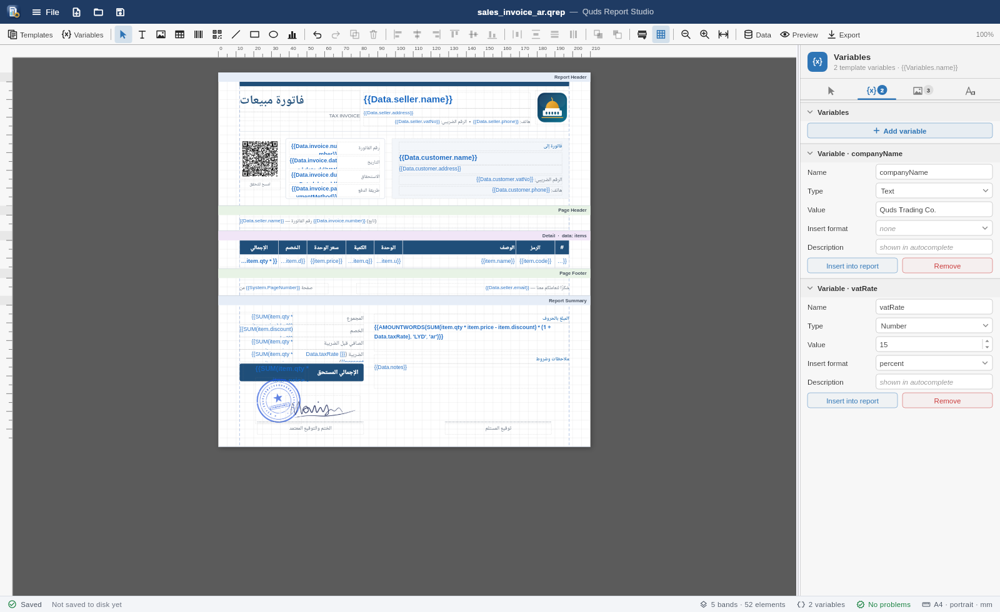
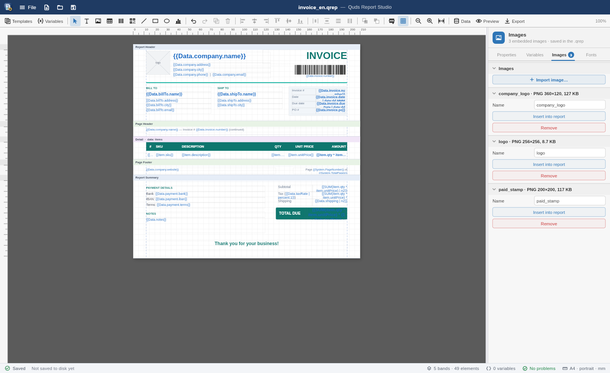
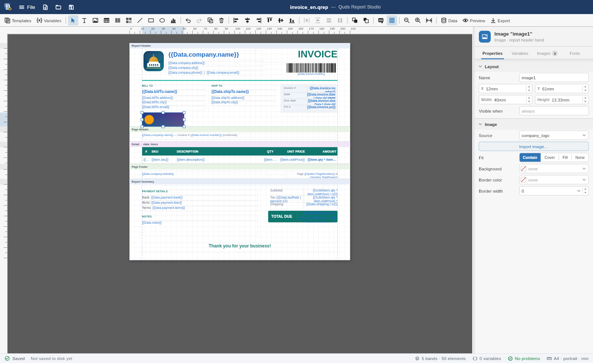
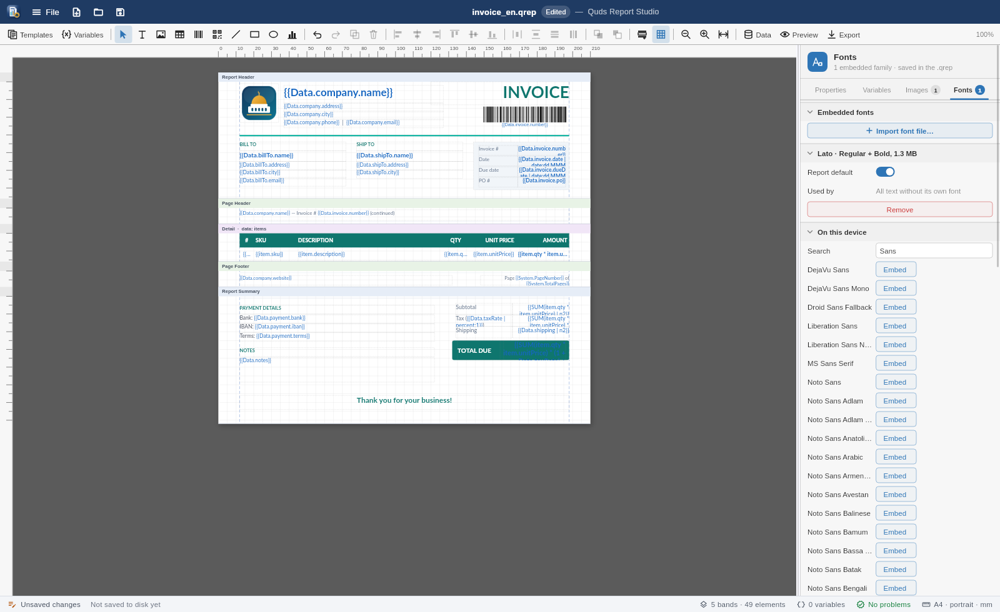
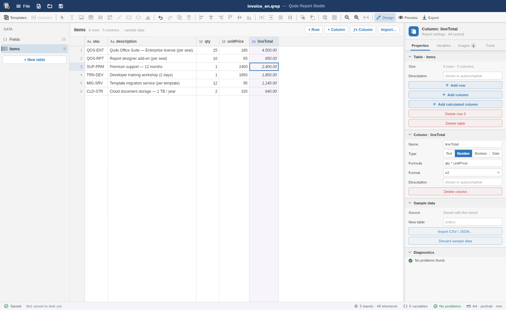
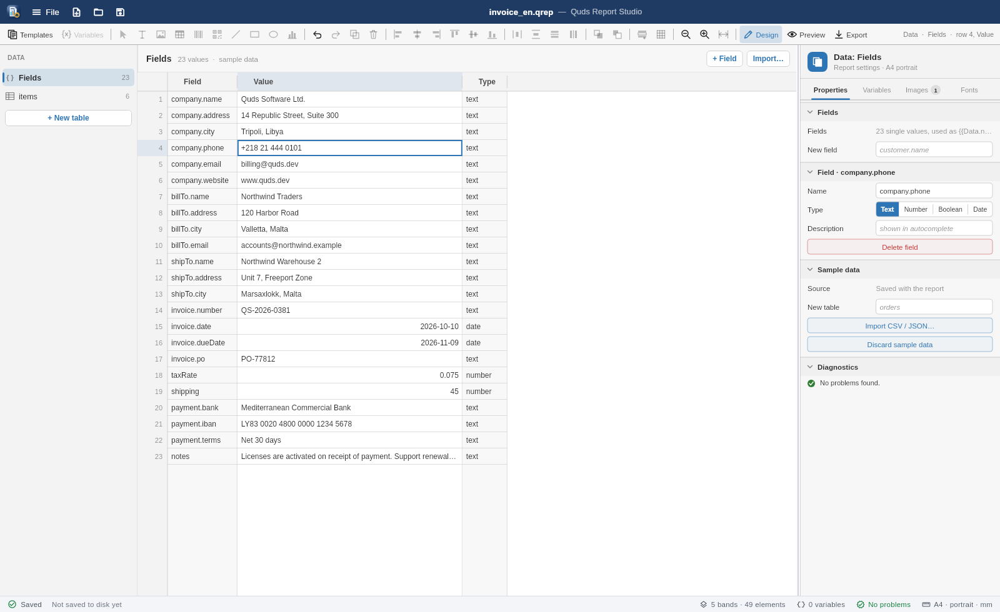
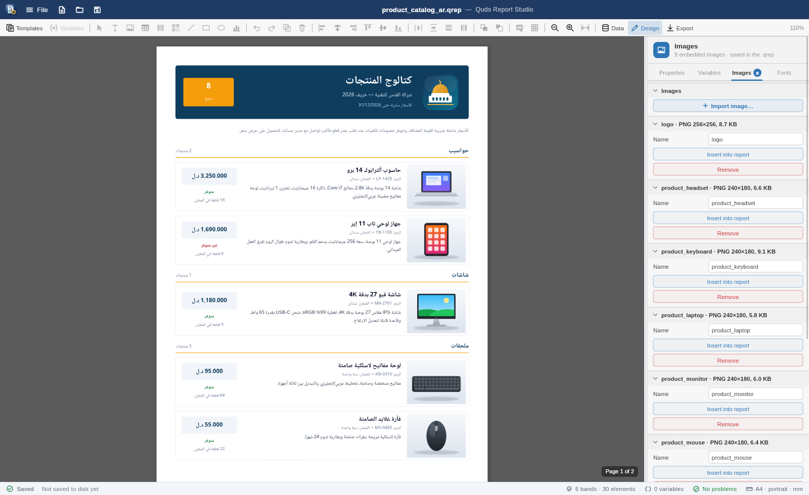
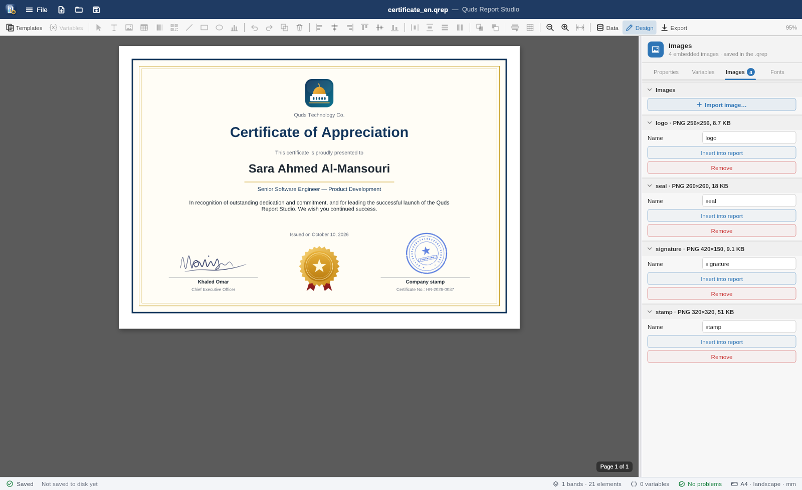

# Quds Report Studio

A standalone desktop editor for `.qrep` band reports: open, design, preview,
and export invoices, statements, dashboards, and vouchers. Arabic RTL and
English LTR are both first-class.

It is a thin host around
[`QudsReportDesigner`](../../packages/quds_office_editor/README.md#report-designer)
from `quds_office_editor`. The report engine, expressions, and exporters come
from the pure-Dart
[`quds_office_engine`](../../packages/quds_office_engine/README.md#band-reports-quds_reportsdart).


## Download

| Platform | Installer | Portable |
| --- | --- | --- |
| Windows 10/11 (x64) | [QudsReportStudio-1.0.0-windows-x64-setup.exe](https://github.com/MohammedAsaadAsaad/quds_office_suite/releases/download/studio-v1.0.0/QudsReportStudio-1.0.0-windows-x64-setup.exe) | [QudsReportStudio-1.0.0-windows-x64-portable.zip](https://github.com/MohammedAsaadAsaad/quds_office_suite/releases/download/studio-v1.0.0/QudsReportStudio-1.0.0-windows-x64-portable.zip) |
| Debian / Ubuntu (x64) | [quds-report-studio_1.0.0_amd64.deb](https://github.com/MohammedAsaadAsaad/quds_office_suite/releases/download/studio-v1.0.0/quds-report-studio_1.0.0_amd64.deb) | [QudsReportStudio-1.0.0-linux-x64.tar.gz](https://github.com/MohammedAsaadAsaad/quds_office_suite/releases/download/studio-v1.0.0/QudsReportStudio-1.0.0-linux-x64.tar.gz) |

Checksums are on the
[release page](https://github.com/MohammedAsaadAsaad/quds_office_suite/releases/tag/studio-v1.0.0).

### Install and uninstall

| Package | Install | Uninstall |
| --- | --- | --- |
| Windows setup | Run it. It installs for the current user without admin rights, or for all users if you pick that in the first dialog | *Settings › Apps › Quds Report Studio*. This also removes the `.qrep` association |
| Windows portable | Extract the zip and run `quds_report_studio.exe` | Run `unregister-qrep.cmd`, then delete the folder |
| `.deb` | `sudo apt install ./quds-report-studio_1.0.0_amd64.deb` | `sudo apt remove quds-report-studio` |
| Linux tar.gz | Extract it and run `./install.sh` (per user, into `~/.local/opt/quds-report-studio`) | `~/.local/opt/quds-report-studio/uninstall.sh` (add `--purge` to delete settings) |

### Opening `.qrep` files

On its first run the studio registers itself as the app for `.qrep` files:

- **Windows:** it writes the `.qrep` → `QudsReportStudio.qrep` keys under
  `HKEY_CURRENT_USER\Software\Classes`, with the report icon from the exe.
- **Linux:** it installs the `application/vnd.quds.qrep+zip` MIME type, a
  desktop entry, and the icons under `~/.local/share`, then makes itself
  the default with `xdg-mime`. When it runs from the `.deb`, it uses the
  system-wide files instead.

After that, double-clicking a `.qrep` file in Explorer, Files, Dolphin, and
other file managers opens it in the studio. If you move the app, it
registers again on its next run from the new location. **File › Open .qrep
files with Report Studio** forces it again, for example after another
app took over the type.

## Run

```bash
cd apps/quds_report_studio
flutter run -d linux            # or windows, macos
flutter run -d linux -a invoice.qrep   # open a file at startup
```

Build a release binary with `flutter build linux` (or `windows`, `macos`).
The app is part of the repository's Dart workspace, so run `dart pub get` at
the repository root first.

## What you get

| Area | Details |
| --- | --- |
| **Window** | Frameless window with its own title bar: drag to move, double-click to maximize, resize from any edge, minimize / maximize / close buttons |
| **Files** | New blank report, New from template (by category, Arabic or English), Open (`.qrep` / `.xml`), Open recent (last 10, persisted), Save, Save as. Reports save as `.qrep` packages (ZIP: `layout.xml` + embedded images and fonts); older plain-XML files still open |
| **Images** | Import PNG / JPEG into the report (the inspector's Images tab, or **Import image…** on an image element). Images are stored inside the `.qrep`, then renamed, inserted, or removed with undo |
| **Fonts** | Pick installed fonts or `.ttf` files on the inspector's Fonts tab. They are embedded in the `.qrep`, so the report looks the same on machines that lack them |
| **Safety** | An "Edited" chip in the title; closing the window, opening, or creating a report while edited asks to Save / Don't save / Cancel |
| **Designer** | Bands, rulers, snapping, align / distribute, z-order, clipboard, undo / redo, inline text editing with `{{ }}` autocomplete |
| **Inspector** | Properties / Variables / Images / Fonts tabs, collapsible sections, switches, segmented icon choices, dropdowns, steppers, preset combos, paired X/Y and W/H, color palette popover. Drag its edge to resize; the width is remembered (double-click restores 320 px) |
| **Data** | F6: a Power BI-style data explorer. Browse and edit the report's tables and fields, add or delete rows and columns, add calculated `ƒx` columns, and import CSV / JSON. The data is saved in the `.qrep` |
| **Element names** | Every element has a unique name, edited in the inspector, so code can fill the report by name |
| **Preview** | F5: paginated output from the engine with real fonts and vector charts |
| **Export** | PDF, XLSX, or DOCX to a file of your choice |
| **Status bar** | Saved state and path, bands · elements, variables, live diagnostics, page size · orientation · unit |

### Keyboard

| Keys | Action |
| --- | --- |
| Ctrl+N | New blank report |
| Ctrl+O | Open |
| Ctrl+S / Ctrl+Shift+S | Save / Save as |
| F5 | Design ↔ preview |
| F6 | Design ↔ data explorer |
| Ctrl+Z / Ctrl+Y | Undo / redo |
| Ctrl+= / Ctrl+- / Ctrl+0 | Zoom in / out / fit width |

All designer shortcuts are listed in the
[editor README](../../packages/quds_office_editor/README.md#keyboard).

## Tour

### Report settings

With nothing selected, the **Properties** tab edits the report: name,
direction, default font, unit, page size and margins, and the color palette.
Variables and images have their own tabs, so this page stays short.


To make the inspector wider or narrower, drag the splitter on its left edge.
The width is remembered between runs, and double-clicking the splitter
restores 320 px.

### Typed variables

The **Variables** tab lists the template variables. Each has a name, a type
(text, number, boolean, date, list, expression), a value, an insert format,
and a description. **Insert into report** places `{{Variables.name}}` at the
caret or as a new text box.



### Text element

Paired position and size steppers, alignment icons, switches for grow /
shrink / wrap, font presets, and a B/I/U row.


### Colors without typing hex


### Autocomplete inside `{{ }}`

Data fields come from the preview data. Functions, `System.*`, `Variables.*`,
and format specs after `|` are suggested as you type.


### Images saved inside the report

**Import image…** on the **Images** tab embeds a PNG or JPEG in the report.
The image is stored in the `.qrep` package, so it isn't supplied when the
report is generated. Each image gets its own section showing its type, pixel size, and file size, with
Rename, Insert into report, and Remove. All of these can be undone.



An image element's Source field suggests the embedded names. **Import
image…** on the element embeds a new file and switches the element to it.



### Fonts embedded in the report

The **Fonts** tab lists the fonts installed on your computer under **On
this device**. Search the list, then click **Embed** to embed a family.
Typing an installed family into any font field embeds it too. **Import font
file…** embeds `.ttf` files directly.

Embedded fonts are stored in the `.qrep` next to the layout. The canvas, the
preview, and every export use them, so the report comes out as designed even
on a machine where the font isn't installed. Each family keeps its regular
and bold faces. Its section shows the file size and how many elements use
it, with a **Report default** switch and Remove (both undoable).

The studio reads fonts from the usual folders:

| OS | Folders |
| --- | --- |
| Linux | `/usr/share/fonts`, `/usr/local/share/fonts`, `~/.local/share/fonts`, `~/.fonts` |
| Windows | `%WINDIR%\Fonts`, `%LOCALAPPDATA%\Microsoft\Windows\Fonts` |
| macOS | `/System/Library/Fonts`, `/Library/Fonts`, `~/Library/Fonts` |

The scan runs once in the background and reads only font headers. It lists
TrueType (`.ttf`) families whose license allows embedding. `.otf` (CFF)
fonts and `.ttc` collections are not listed.



### Data explorer

**Data** on the toolbar (F6) shows the data the report prints, in a grid
like the data view in Power BI. The sidebar lists **Fields**, which are
single values such as `Data.invoice.number`, and every table with its row
count.



- Double-click a cell, press F2, or just type to edit it. Enter and Tab move
  on, and values are checked against the column type.
- **+ Row**, **+ Column**, and **ƒx Column** add rows, typed columns, and
  calculated columns. A calculated column uses a formula such as
  `qty * unitPrice` that is evaluated for every row in the preview and in
  every export.
- Right-click a cell for insert above/below, rename, and delete. Renaming a
  column or field also updates the report's bindings (`item.qty`,
  `SUM(items.qty)`, `Data.customer`).
- **Import…** reads a CSV, TSV, or JSON file into the current table or
  replaces the whole sample data.



The sample data is saved inside the `.qrep` (`data/sample.json`), and every
change can be undone. Column types and formulas are saved in the layout's
`<DataSchema>`, so the real data your application feeds at run time gets
the same types and calculated columns.

### Feeding the report from code

Every element on the report has a unique name (`title`, `itemsTable`,
`logo`), shown and edited in the inspector's **Name** field. Your
application opens the `.qrep`, fills elements by name, and exports:

```dart
final QudsReportEngine engine = QudsReportEngine.fromPackage(
  File('invoice.qrep').readAsBytesSync(),
  fonts: fonts,
);
engine.data.set('customer', 'Northwind Traders');
engine.setText('title', 'Invoice {{Data.invoice.number}}');
engine.setTableRows('itemsTable', orderLines);
engine.setVisible('paidStamp', paid);
File('invoice.pdf').writeAsBytesSync(
  await engine.export(ReportExportFormat.pdf),
);
```

See the engine's
[named elements](../../packages/quds_office_engine/README.md#named-elements-fill-a-report-from-code)
section for the full API.

### Arabic RTL templates


### Templates

**File › New from template** opens a categorized catalog: pick a category
(Sales, Finance, Inventory, Analytics, Human resources), then a family, then
**العربية** or **English**. Each of the eight families ships both versions
(16 templates):

| Category | Templates |
| --- | --- |
| Sales | VAT sales invoice, commercial invoice, product catalog |
| Finance | Customer account statement, receipt voucher |
| Inventory | Inventory status |
| Analytics | Sales performance dashboard |
| Human resources | Certificate of appreciation |

Templates open with sample data, so the preview is meaningful right away,
and with their **pre-saved images**: company logo, stamp, signature, seal,
and a photo for every product in the catalog. The images appear in the
Images tab and are saved inside the `.qrep`, so you can replace them with
your own under the same names.






### Live preview


## Where things are stored

Recent files are saved to `recent.json` and preferences (the inspector
width and where `.qrep` files were last associated) to `settings.json` in:

| OS | Folder |
| --- | --- |
| Linux | `$XDG_CONFIG_HOME/quds_report_studio` (or `~/.config/quds_report_studio`) |
| Windows | `%APPDATA%\quds_report_studio` |
| macOS | `~/Library/Application Support/quds_report_studio` |

## Source layout

| File | Role |
| --- | --- |
| `lib/main.dart` | Startup: fonts, window bootstrap, recent files, initial path |
| `lib/src/report_studio_page.dart` | Title bar, File menu, shortcuts, designer, status bar |
| `lib/src/report_document.dart` | Open / save / dirty tracking around `ReportDesignerController` |
| `lib/src/recent_files.dart` | Persistent recent-file list |
| `lib/src/studio_settings.dart` | Persistent preferences (inspector width, associated executable) |
| `lib/src/file_association.dart` | First-run `.qrep` association (`QrepFileAssociation`): freedesktop MIME + desktop entry, Windows registry |
| `lib/src/device_fonts.dart` | Installed-font scan (`StudioDeviceFonts`) for the Fonts tab |
| `lib/src/studio_window.dart` | `window_manager` chrome: drag, resize edges, caption buttons, close guard |
| `tool/make_icons.py` | Draws the app and `.qrep` icons and writes every platform size |
| `packaging/linux/` | `.deb` and tar.gz builder, `install.sh` / `uninstall.sh`, MIME type, desktop entry, icons |
| `packaging/windows/` | Inno Setup script (setup + uninstaller) and `unregister-qrep.cmd` |

## Icons

`tool/make_icons.py` (Python 3 + Pillow) draws the app icon and the `.qrep`
document icon. It writes the Windows `.ico` files, the Linux hicolor PNGs
(16–512 px), the macOS app icon set, the web icons, and `assets/icon/`.
Run it again after changing the design.

## Build the installers

The
[`report-studio-release`](../../.github/workflows/report-studio-release.yml)
workflow builds every package and attaches it to a GitHub release when a
`studio-vX.Y.Z` tag is pushed. To build them yourself:

```bash
# Linux (.deb + tar.gz into build/dist); needs dpkg-deb
flutter build linux --release
packaging/linux/build_packages.sh

# Windows (setup.exe); needs Inno Setup 6
flutter build windows --release
iscc /DAppVersion=1.0.0 packaging\windows\quds_report_studio.iss
```

## Tests and screenshots

```bash
flutter test                                              # unit + widget tests
QUDS_SHOTS_DIR=screenshots flutter test test/shots_test.dart   # regenerate screenshots
```

The screenshot test loads the real Liberation and Noto Naskh Arabic fonts,
so the images match the running app.
