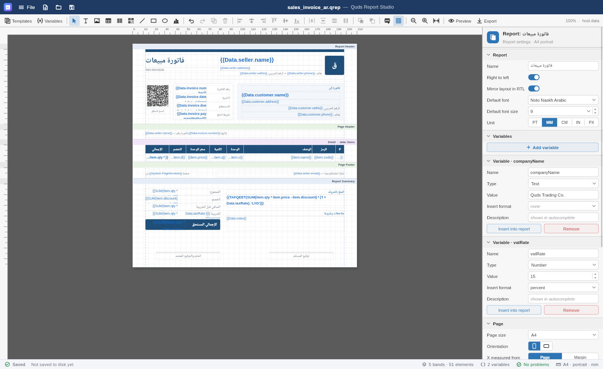
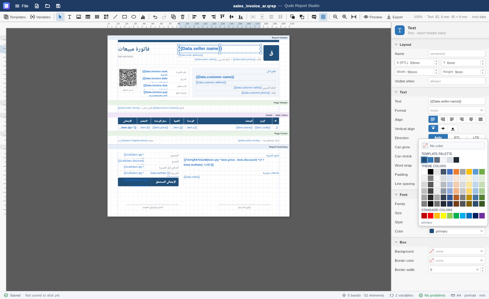
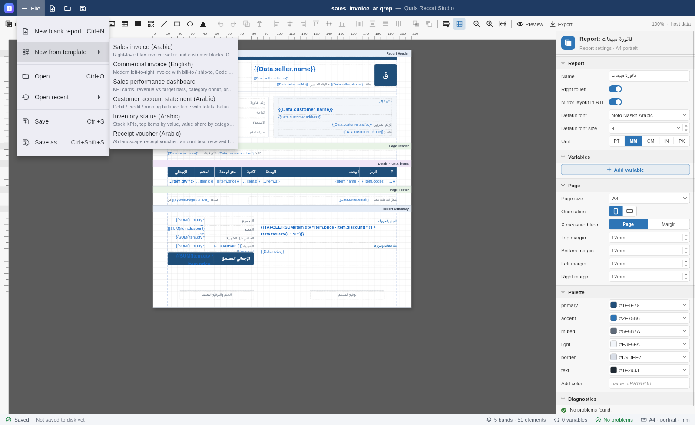

# Quds Report Studio

A standalone desktop editor for `.qrep` band reports: open, design, preview,
and export invoices, statements, dashboards, and vouchers. Arabic RTL and
English LTR are both first-class.

It is a thin host around
[`QudsReportDesigner`](../../packages/quds_office_editor/README.md#report-designer)
from `quds_office_editor`. The report engine, expressions, and exporters come
from the pure-Dart
[`quds_office_engine`](../../packages/quds_office_engine/README.md#band-reports-quds_reportsdart).


## Run

```bash
cd apps/quds_report_studio
flutter run -d linux            # or windows, macos
flutter run -d linux -a invoice.qrep   # open a file at startup
```

Build a release binary with `flutter build linux` (or `windows`, `macos`).
The app is part of the repository's Dart workspace, so run `dart pub get` at
the repository root first.

## What you get

| Area | Details |
| --- | --- |
| **Window** | Frameless window with its own title bar: drag to move, double-click to maximize, resize from any edge, minimize / maximize / close buttons |
| **Files** | New blank report, New from template, Open (`.qrep` / `.xml`), Open recent (last 10, persisted), Save, Save as |
| **Safety** | An "Edited" chip in the title; closing the window, opening, or creating a report while edited asks to Save / Don't save / Cancel |
| **Designer** | Bands, rulers, snapping, align / distribute, z-order, clipboard, undo / redo, inline text editing with `{{ }}` autocomplete |
| **Inspector** | Collapsible sections, switches, segmented icon choices, dropdowns, steppers, preset combos, paired X/Y and W/H, color palette popover |
| **Preview** | F5: paginated output from the engine with real fonts and vector charts |
| **Export** | PDF, XLSX, or DOCX to a file of your choice |
| **Status bar** | Saved state and path, bands · elements, variables, live diagnostics, page size · orientation · unit |

### Keyboard

| Keys | Action |
| --- | --- |
| Ctrl+N | New blank report |
| Ctrl+O | Open |
| Ctrl+S / Ctrl+Shift+S | Save / Save as |
| F5 | Design ↔ preview |
| Ctrl+Z / Ctrl+Y | Undo / redo |
| Ctrl+= / Ctrl+- / Ctrl+0 | Zoom in / out / fit width |

All designer shortcuts are listed in the
[editor README](../../packages/quds_office_editor/README.md#keyboard).

## Tour

### Report settings and typed variables

With nothing selected, the inspector edits the report: name, direction,
default font, unit, variables (typed, with formats), page size and margins,
and the color palette.



### Text element

Paired position and size steppers, alignment icons, switches for grow /
shrink / wrap, font presets, and a B/I/U row.


### Colors without typing hex



### Autocomplete inside `{{ }}`

Data fields come from the preview data. Functions, `System.*`, `Variables.*`,
and format specs after `|` are suggested as you type.


### Arabic RTL templates


### Templates

Six ready-made templates load with sample data so the preview is meaningful
immediately.



### Live preview


## Where things are stored

Recent files are saved to `recent.json` in:

| OS | Folder |
| --- | --- |
| Linux | `$XDG_CONFIG_HOME/quds_report_studio` (or `~/.config/quds_report_studio`) |
| Windows | `%APPDATA%\quds_report_studio` |
| macOS | `~/Library/Application Support/quds_report_studio` |

## Source layout

| File | Role |
| --- | --- |
| `lib/main.dart` | Startup: fonts, window bootstrap, recent files, initial path |
| `lib/src/report_studio_page.dart` | Title bar, File menu, shortcuts, designer, status bar |
| `lib/src/report_document.dart` | Open / save / dirty tracking around `ReportDesignerController` |
| `lib/src/recent_files.dart` | Persistent recent-file list |
| `lib/src/studio_window.dart` | `window_manager` chrome: drag, resize edges, caption buttons, close guard |

## Tests and screenshots

```bash
flutter test                                              # unit + widget tests
QUDS_SHOTS_DIR=screenshots flutter test test/shots_test.dart   # regenerate screenshots
```

The screenshot test loads the real Liberation and Noto Naskh Arabic fonts,
so the images match the running app.
