# quds_office_editor

<p>
  <a href="https://pub.dev/packages/quds_office_editor"></a>
  <a href="https://pub.dev/packages/quds_office_editor/score"></a>
  <a href="https://github.com/MohammedAsaadAsaad/quds_office_suite/blob/main/LICENSE"></a>
  
  
  
</p>

**Embeddable Word, Excel, PowerPoint, PDF, and band-report designer surfaces
for Flutter.** Every document surface is a custom `RenderBox`. Not
`TextField`. Not `ListView`. Not `InteractiveViewer`.

This is the interaction half of
[Quds Office Suite](https://github.com/MohammedAsaadAsaad/quds_office_suite).
Documents, formulas, pagination, `PdfFile`, `pdf_widgets`, and the `.qrep`
report engine live in the pure-Dart
[`quds_office_engine`](https://pub.dev/packages/quds_office_engine). You draw
the ribbon, the file menu, and the window chrome. This package paints the
document.

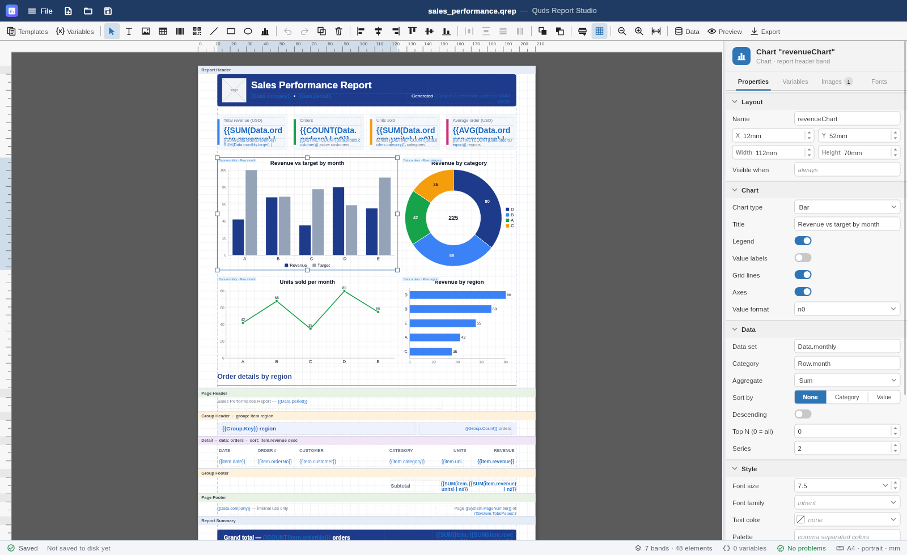

<table>
  <tr>
    <td width="50%"><br/><b>Word</b>: paginated canvas, BiDi caret, outline</td>
    <td width="50%"><br/><b>Excel</b>: virtualized grid, formulas, charts</td>
  </tr>
  <tr>
    <td><br/><b>PowerPoint</b>: stage, animations, slideshow</td>
    <td><br/><b>PDF</b>: viewer and editor with thumbnails</td>
  </tr>
  <tr>
    <td>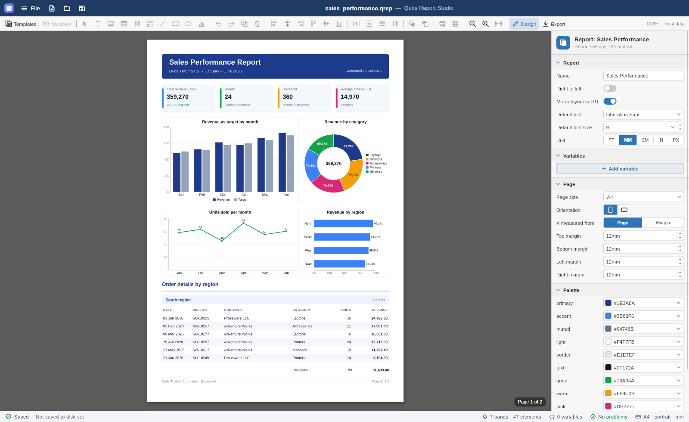<br/><b>Report preview</b>: paginated, engine-painted</td>
    <td>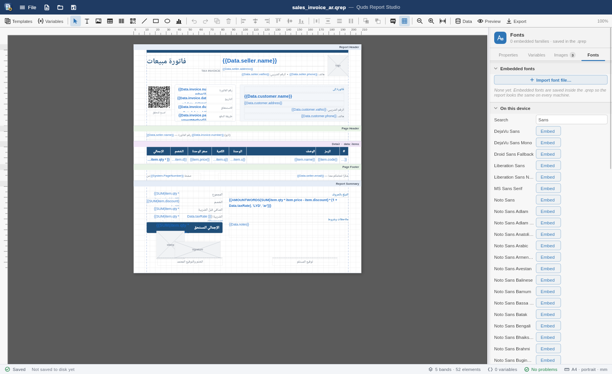<br/><b>RTL reports</b>: Arabic invoice, mirrored layout</td>
  </tr>
</table>

> **Try the report designer without writing code:**
> [Quds Report Studio](#quds-report-studio-app) is a desktop app built on
> `QudsReportDesigner`. Download the
> [Windows installer](https://github.com/MohammedAsaadAsaad/quds_office_suite/releases/download/studio-v1.4.0/QudsReportStudio-1.4.0-windows-x64-setup.exe)
> or the
> [Linux .deb](https://github.com/MohammedAsaadAsaad/quds_office_suite/releases/download/studio-v1.4.0/quds-report-studio_1.4.0_amd64.deb)
> ([all downloads](https://github.com/MohammedAsaadAsaad/quds_office_suite/releases/tag/studio-v1.4.0)).

## What 1.0 brings

1.0 is the first stable release, built on `quds_office_engine` 1.0. From
here on the public API follows semantic versioning, and breaking changes
wait for 2.0. Every image below is a real frame painted by the widgets in
this package, with real fonts, from `flutter test`.

<table>
  <tr>
    <td width="50%">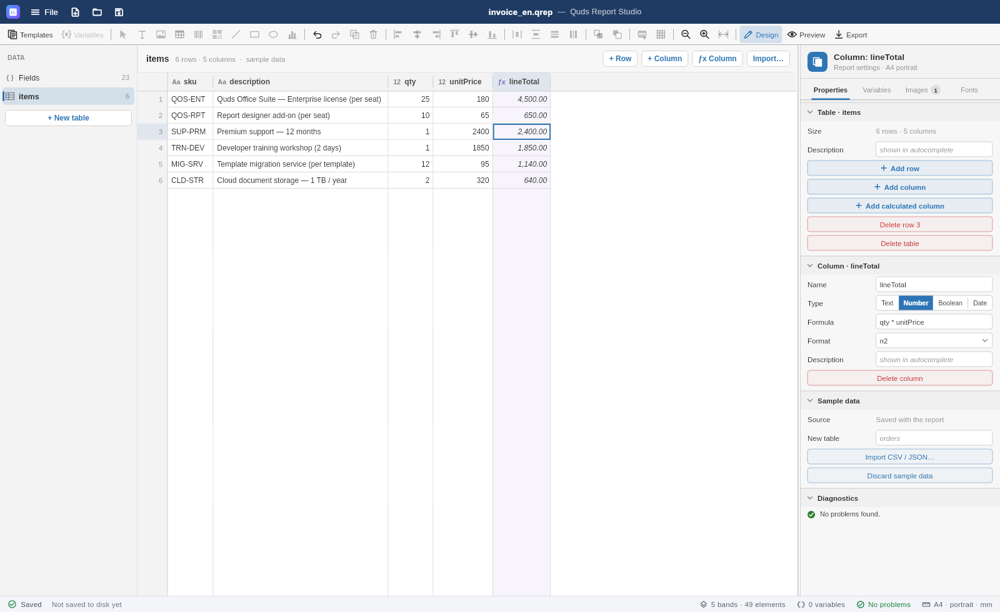</td>
    <td width="50%">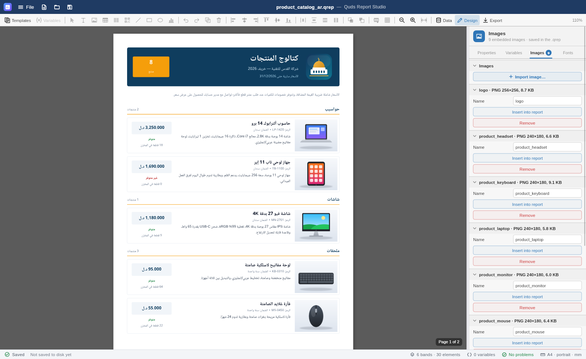</td>
  </tr>
  <tr>
    <td><b>Data explorer</b> (F6): a painted grid over the report's sample data. Typed columns, calculated <b>ƒx</b> columns, CSV / JSON import, safe renames</td>
    <td><b>18 bilingual templates</b>: each loads with its sample data and its logo, stamp, and product photos saved inside the <code>.qrep</code></td>
  </tr>
  <tr>
    <td>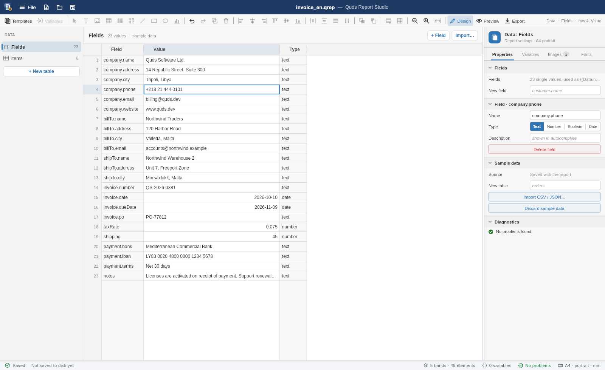</td>
    <td></td>
  </tr>
  <tr>
    <td><b>Typed fields</b>: every single value the report uses, with its type and a description that shows in suggestions</td>
    <td><b>Templates by category</b>: sales, finance, inventory, analytics, and HR, each in Arabic or English</td>
  </tr>
</table>

**Suggestions that know your data.** Add a calculated column in the data
explorer, and it is offered at once inside `{{ }}`, with its computed value:

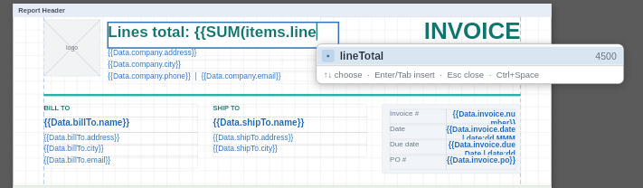

- **Report designer**: data explorer, typed data schema, inspector tabs
  (Properties, Variables, Images, Fonts) in a resizable panel, element
  names that hosts fill from code, and 16 Arabic and English templates.
  Images and TrueType fonts are saved inside the `.qrep`.
- **Office surfaces**: the Word canvas lays out with the same Flutter text
  metrics it paints with, so lines fit their column. The slide stage paints
  unfilled shapes and placeholders the way PowerPoint does, honors text
  colors, and places the `navigationBuilder` and `notesPaneBuilder` panes.
- **Built for real files**: what the engine 1.0 imports (style chains,
  shared formulas, number formats, layouts, theme colors) shows up in these
  surfaces with no extra code.

## Contents

- [What 1.0 brings](#what-10-brings)
- [Install](#install)
- [The surfaces at a glance](#the-surfaces-at-a-glance)
- [Report designer](#report-designer)
  - [Embed it](#embed-it) · [The canvas](#the-canvas) · [The inspector](#the-inspector) · [Autocomplete](#expressions-and-autocomplete) · [Templates and variables](#templates-and-variables) · [Preview and export](#preview-and-export) · [Data explorer](#data-explorer) · [Keyboard](#keyboard) · [Quds Report Studio](#quds-report-studio-app)
- [Why a custom RenderBox](#why-a-custom-renderbox)
- [Languages and writing directions](#languages-and-writing-directions)
- [Host fonts](#host-fonts)
- [Word](#word) · [Excel](#excel) · [PowerPoint](#powerpoint) · [PDF viewer and editor](#pdf-viewer-and-editor)
- [Theming, modes, and chrome](#theming-modes-and-chrome)
- [Load, save, progress](#load-save-progress)
- [What this package refuses to be](#what-this-package-refuses-to-be)
- [Studio example](#studio-example) · [Architecture](#architecture)

---

## Install

```yaml
dependencies:
  quds_office_editor: ^1.4.0
```

```bash
flutter pub add quds_office_editor
```

Requires Flutter **3.44+** and Dart **3.12+**. The engine comes along as
`quds_office_engine: ^1.4.0`. Everything is exported from one library:

```dart
import 'package:quds_office_editor/quds_office_editor.dart';
```

Register the bundled fonts once, before the first frame:

```dart
Future<void> main() async {
  WidgetsFlutterBinding.ensureInitialized();
  await OfficeHostFonts.ensureRegistered();
  runApp(const MyApp());
}
```

## The surfaces at a glance

| Widget | Controller | What it paints |
| --- | --- | --- |
| `QudsWordEditor` | `WordEditorController` | Paginated pages, caret, tables, comments, headers and footers, OMML, pictures |
| `QudsSheetEditor` | `SheetEditorController` | Virtualized grid, formula bar, freeze panes, fill handle, charts |
| `QudsSlideEditor` | `SlideEditorController` | Slide stage, transform handles, snap guides, animations, slideshow |
| `QudsPdfViewer` | `PdfViewerController` | Read-only PDF pages, zoom, find, copy, links, rotation |
| `QudsPdfEditor` | `PdfEditorController` | The same canvas plus markup, form fill, page ops, incremental save |
| `QudsReportDesigner` | `ReportDesignerController` | Band-report canvas, toolbar, inspector, live preview, autocomplete |

```text
┌─ your Scaffold / desktop frame ──────────────────────────┐
│  toolbarBuilder  (optional — your ribbon)                │
│  ┌─────────────────────────────────────────────────────┐ │
│  │  QudsWordEditor / QudsSheetEditor / QudsSlideEditor │ │
│  │  QudsPdfViewer / QudsPdfEditor / QudsReportDesigner │ │
│  │  RenderBox  ·  IME  ·  selection  ·  undo           │ │
│  └─────────────────────────────────────────────────────┘ │
│  statusBarBuilder (optional)                             │
└──────────────────────────────────────────────────────────┘
```

---

## Report designer

A visual designer for `.qrep` **band reports**: invoices, statements,
dashboards, vouchers. It works like Crystal Reports or FastReport, but it is
pure Flutter `RenderBox` with no platform views. The templates, expressions,
pagination, and exporters come from the engine's
[`quds_reports.dart`](https://pub.dev/documentation/quds_office_engine/latest/quds_reports/).


### Charts and shape maps

The inspector lists every chart type and the plot controls that apply to the
one you selected: depth and skew, hole and start angle, markers, curves,
axis bounds, a target, and bands. **Import shapes…** on a shape map reads a
shapefile (`.shp` with its `.dbf`), GeoJSON, or `.qmap`, embeds that file in
the report, and binds the region key to the value table. Until you import a
file, the chart draws the world atlas. Insert tools sit in a side toolbox,
and the map is its own tool. Region labels choose a field from the layer,
including a calculated column. Title, labels, and the legend each open their
own format box: family, size, bold, italic, and color.

<table>
  <tr>
    <td width="50%">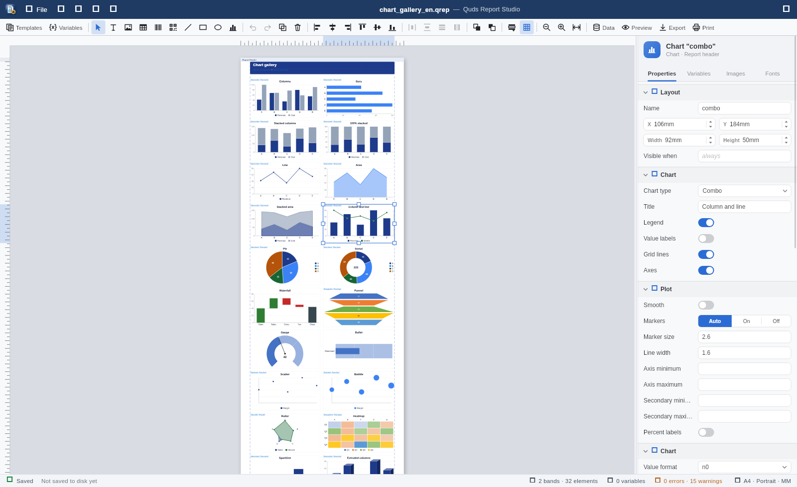</td>
    <td width="50%">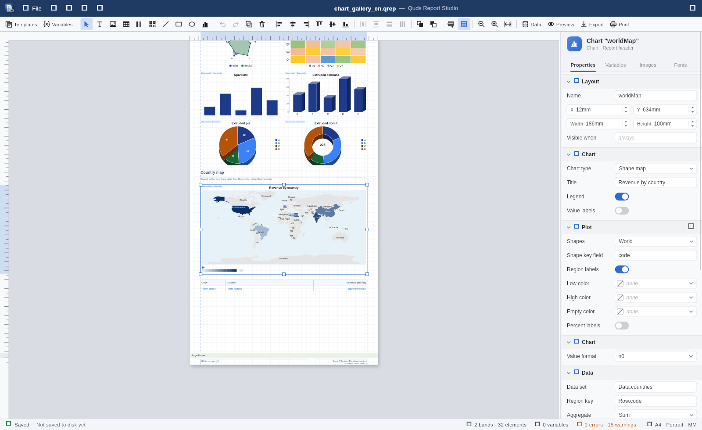</td>
  </tr>
  <tr>
    <td>Chart gallery: the combo chart and its plot controls</td>
    <td>Shape map: world atlas, or your own file, keyed to the value table</td>
  </tr>
</table>

### Embed it

```dart
import 'dart:io';
import 'dart:typed_data';

import 'package:flutter/material.dart';
import 'package:quds_office_editor/quds_office_editor.dart';

class ReportHost extends StatefulWidget {
  const ReportHost({super.key});

  @override
  State<ReportHost> createState() => _ReportHostState();
}

class _ReportHostState extends State<ReportHost> {
  final ReportDesignerController controller = ReportDesignerController();

  @override
  void initState() {
    super.initState();
    ReportTemplateLibrary.bundled().then(
      (List<ReportTemplateInfo> all) => controller.loadTemplate(
        all.firstWhere((ReportTemplateInfo t) => t.id == 'sales_invoice_ar'),
      ),
    );
  }

  @override
  void dispose() {
    controller.dispose();
    super.dispose();
  }

  @override
  Widget build(BuildContext context) {
    return QudsReportDesigner(
      controller: controller,
      inspectorWidth: 320,
      // Toolbar "Export" → PDF / XLSX / DOCX bytes, ready to save.
      onExport: (ReportExportFormat format, Uint8List bytes) {
        File('report.${format.name}').writeAsBytesSync(bytes);
      },
    );
  }
}
```

Open and save `.qrep` packages: a ZIP holding the XML layout and the images
and fonts embedded in the report. Older plain-XML `.qrep` files open too:

```dart
final ReportDesignerController c =
    ReportDesignerController.fromPackage(File('invoice.qrep').readAsBytesSync());
File('invoice.qrep').writeAsBytesSync(c.toPackage());

c.loadPackage(bytes);                 // replace the open report, images and fonts
c.loadXml(otherXml);                  // or a bare layout (nothing embedded)
c.mockData = <String, Object?>{...};  // your own preview data (or inferred)
final Uint8List pdf = await c.export(ReportExportFormat.pdf);
```

Embedded images are saved with the report and are not supplied at export
time. Each one is a PNG or JPEG keyed by name and drawn by
`<Image source="name"/>`. Every change goes through the undo history:

```dart
final String? key = c.addImage('Company Logo.png', bytes); // 'Company_Logo'
c.insertImage(key!);              // new <Image> in the selected band, aspect kept
c.renameImage(key, 'logo');       // repoints <Image source="Company_Logo">
c.removeImage('logo');
```

Pass `onPickImage` to show the import buttons. The inspector's **Images**
tab lists each image with its type, pixel size, and file size, plus Insert
and Remove. Image elements get an
**Import image…** button, and their Source field suggests the embedded
names. Any file picker works:

```dart
QudsReportDesigner(
  controller: c,
  onPickImage: () async {
    final FilePickerResult? r = await FilePicker.platform.pickFiles(
      type: FileType.custom,
      allowedExtensions: <String>['png', 'jpg', 'jpeg'],
      withData: true,
    );
    final PlatformFile? f = r?.files.firstOrNull;
    return f?.bytes == null ? null : (name: f!.name, bytes: f.bytes!);
  },
);
```

#### Embedded fonts

Fonts embedded in a report are saved inside the `.qrep`, so it exports with
the same faces on any machine, even one that never had them installed. The
preview, the charts, and the exports use `controller.effectiveFonts`: the
host `fonts` plus the embedded families the host lacks. The design canvas
loads embedded families into Flutter so text there looks the same. Each
family keeps one regular and one bold TrueType face. Edits are undoable:

```dart
final String family = c.addFont(File('Amiri-Regular.ttf').readAsBytesSync());
c.addFont(File('Amiri-Bold.ttf').readAsBytesSync()); // fills the bold slot
c.setProperty('defaultFont', family);                 // 'Amiri'
c.removeFont('Amiri');
```

`addFont` reads the family, weight, and italic flag from the file and throws
`ReportFontException` for `.ttc` collections, CFF `.otf` files, italic faces,
and fonts whose license forbids embedding.

The inspector's **Fonts** tab lists embedded families. Each row shows its
faces, its size, a **Report default** switch, and how many elements use it.
Two optional parameters add sources:

- **`onPickFont`** (`ReportFontPicker`) shows **Import font file…** for
  `.ttf` files.
- **`deviceFonts`** (`ReportDeviceFonts`) lists installed families under
  **On this device**, with search and a one-click **Embed**. Typing an
  installed family into a font field embeds it too.

```dart
class MyDeviceFonts implements ReportDeviceFonts {
  @override
  Future<List<String>> families() async => <String>['Amiri', 'Cairo'];

  @override
  Future<ReportFontFiles?> load(String family) async => ReportFontFiles(
    regular: await File('/fonts/$family-Regular.ttf').readAsBytes(),
    bold: await File('/fonts/$family-Bold.ttf').readAsBytes(),
  );
}

QudsReportDesigner(controller: c, deviceFonts: MyDeviceFonts());
```

[Quds Report Studio](https://github.com/MohammedAsaadAsaad/quds_office_suite/tree/main/apps/quds_report_studio)
has a ready-made implementation that scans the OS font folders.

`QudsReportDesigner` parameters:

| Parameter | Default | Purpose |
| --- | --- | --- |
| `controller` | required | Template, selection, undo, preview data |
| `theme` | `OfficeTheme.light` | Chrome tokens |
| `inspectorWidth` | `300` | Default inspector width; double-clicking the splitter restores it |
| `initialInspectorWidth` | `null` | Starting width, e.g. one saved from `onInspectorWidthChanged` |
| `minInspectorWidth` / `maxInspectorWidth` | `240` / `640` | Drag limits; the canvas always keeps at least 240 px |
| `onInspectorWidthChanged` | `null` | Called with the new width after a splitter drag or reset |
| `onExport` | `null` | Receives exported bytes; hides Export when null |
| `onPrint` | `null` | Receives the report as PDF on **Print** or Ctrl+P, so the host can show a print dialog (for example with the `printing` package); hides Print when null |
| `templates` | `null` | Entries in the Templates menu; null offers the bundled `.qrep` files (`ReportTemplateLibrary.bundled()`) |
| `onPickImage` | `null` | Host file picker for "Import image…" (PNG / JPEG embedded in the `.qrep`); hides the buttons when null |
| `onPickFont` | `null` | Host file picker for "Import font file…" (TrueType embedded in the `.qrep`); hides the button when null |
| `deviceFonts` | `null` | Installed fonts listed on the Fonts tab for one-click embedding; hides the list when null |
| `onPickData` | `null` | Host file picker for the data explorer's "Import CSV / JSON…"; hides the button when null |
| `loadBundledFonts` | `true` | Loads Liberation + Noto Naskh Arabic into the preview/export registry |
| `focusNode` / `autofocus` | internal / `true` | Keyboard focus |

### The canvas


- **Bands**: report header, page header, group header/footer, detail (bound
  to a data set), page footer, report summary. Add, remove, and resize bands.
  Each band is labeled with its kind and data source.
- **Tools**: text, image, table, barcode, QR code, line, rectangle, ellipse,
  and chart. Click to place or drag to size, then edit.
- **Direct manipulation**: select, marquee, move across bands, resize with
  eight handles, and nudge with the arrow keys. Snapping uses the grid and
  smart guides.
- **Arrange**: align left/center/right/top/middle/bottom, distribute, same
  width/height, bring forward and send back, copy/cut/paste, and duplicate.
- **Rulers** in the template's unit (mm, cm, in, pt, px) and zoom (fit width,
  in, out).
- **RTL**: Arabic templates mirror X in the designer (`X (RTL)`), shape text,
  and keep the authored coordinates in the file.
- **Inline editing** on the canvas, with a caret, selection, and IME. The
  editor switches to black or white text when the element's own color would
  be unreadable on its fill (WCAG 4.5:1).

### The inspector

The inspector is designed so most edits need **no typing**. Each property
carries metadata (`ReportProperty.hint`, `presets`, `step`, `min`, `pair`,
`glyph`), and the inspector picks the right control from it:

<table>
  <tr>
    <td width="33%">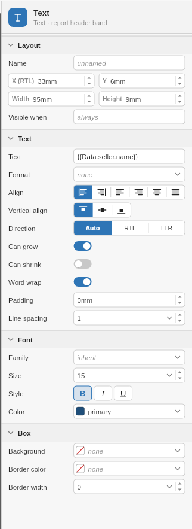</td>
    <td width="33%">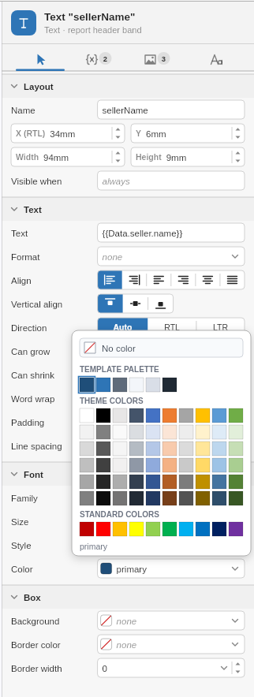</td>
    <td width="33%">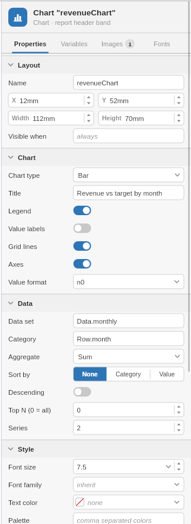</td>
  </tr>
  <tr>
    <td>Text element: paired X/Y and W/H steppers, align icons, switches, B/I/U</td>
    <td>Color popover: template palette, Office theme tints, standard colors</td>
    <td>Chart: type, legend/labels/grid switches, data binding, aggregation, sort</td>
  </tr>
</table>

| Property kind | Control |
| --- | --- |
| Booleans (`canGrow`, `wordWrap`, `legend`, …) | Switch |
| Small enums (align, vertical align, direction, unit, orientation, line style) | Segmented control with painted icons or short labels |
| Larger enums (page size, chart type, aggregate, barcode kind) | Dropdown |
| Lengths and numbers | Field with ▲/▼ steppers; the step follows the unit (1 mm, 0.1 cm, 0.05 in); ↑/↓ while typing, Shift for ×10 |
| Font size, family, number/date format | Combo with presets (format presets show live samples, e.g. `n2 → 1,234.50`) |
| Colors | Swatch + painted palette popover (No color, template palette, 60 theme tints/shades, 10 standard colors) |
| X/Y, Width/Height | Paired fields on one row |
| Bold / Italic / Underline | Toggle glyph row |

The inspector has four tabs:

- **Properties** shows the selection's properties. With nothing selected, it
  shows report settings (Report, Page, Palette, Diagnostics).
- **Variables** shows the template variables.
- **Images** shows the images embedded in the `.qrep`.
- **Fonts** shows the embedded fonts and, with `deviceFonts`, the installed
  ones.

The Variables, Images, and Fonts tabs carry a count badge. When the
inspector is too narrow for the labels, the tabs show icons only. Selecting
an element or a band jumps back to Properties. `controller.inspectorPage`
switches tabs in code.

Sections (Layout, Text, Font, Box, Chart, Data, Style, Report, Page,
Palette, Diagnostics) collapse independently. The title badge shows the
element kind and its band. Diagnostics list template problems with severity
icons.

**Problems panel.** Set `controller.problemsOpen = true` (for example from
a status bar button) to show the problems panel under the canvas;
`problemsHeight` sets its starting height, and its top edge drags to
resize. It lists `controller.problems`: the parser's checks and
`validate()` for the report as it is now, errors first, plus anything the
parser corrected or skipped when the file was opened (until
`clearLoadDiagnostics()`). Each row shows the message, the kind of problem
(`ReportDiagnostic.kind`), and where it is (`ReportDiagnostic.target`).
Clicking a row calls `controller.revealDiagnostic(d)`, which selects the
element or band and scrolls the canvas to it, opens the variable or data
column, and marks the inspector property to fix
(`controller.highlightProperty`). `ReportProblemsPanel` is also exported for
hosts that lay out their own panes.

To resize the inspector, drag the splitter between the canvas and the
inspector. Double-clicking the splitter restores the default width.

<table>
  <tr>
    <td width="25%">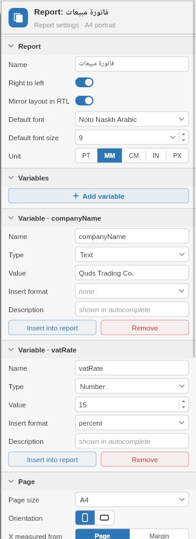</td>
    <td width="25%">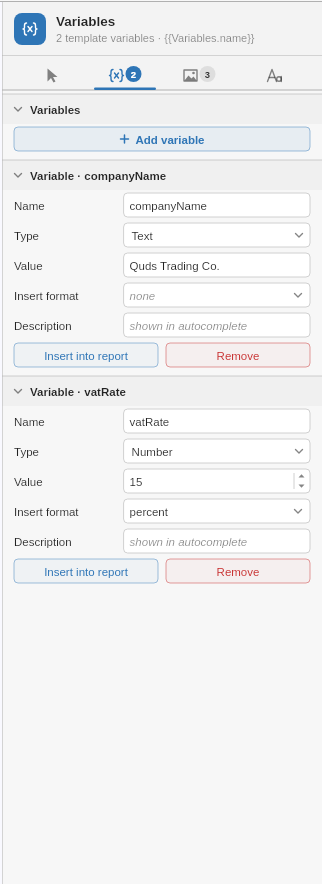</td>
    <td width="25%">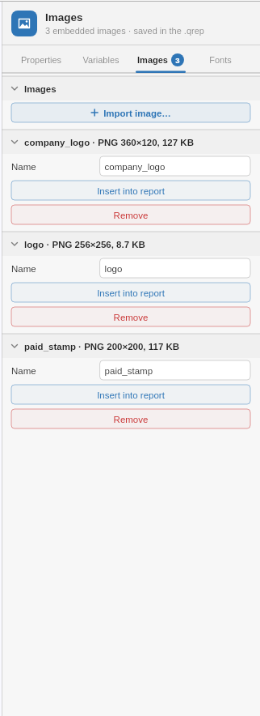</td>
    <td width="25%">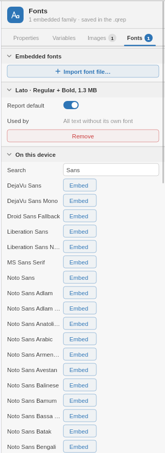</td>
  </tr>
  <tr>
    <td>Properties tab: report settings, page, palette, diagnostics</td>
    <td>Variables tab: typed variables, insert format, Insert / Remove</td>
    <td>Images tab: images saved in the <code>.qrep</code></td>
    <td>Fonts tab: embedded fonts and installed fonts to embed</td>
  </tr>
</table>

### Expressions and autocomplete

Text and expression properties use `{{ … }}` placeholders:
`{{Data.customer.name}}`, `{{item.qty * item.price | n2}}`,
`{{SUM(item.total) | currency:LYD}}`, `{{TAFQEET(Data.total, 'LYD')}}`.
While you type, a painted popup suggests data fields (inferred from the
preview data), functions with signatures, `System.*`, `Group.*`,
`Variables.*`, format specs after `|`, and currency codes.

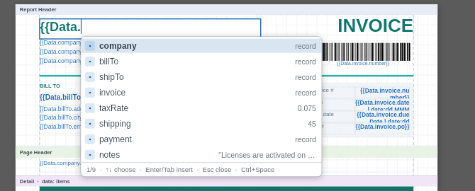

↑/↓ choose, Enter/Tab insert, Esc closes, Ctrl+Space opens it anywhere.
Functions insert `NAME()` with the caret inside.

### Templates and variables


- **Templates**: the toolbar menu groups the template families by category
  (sales, finance, inventory, analytics, human resources). Picking a family
  asks for **العربية** or **English**. Every family ships both versions: VAT
  invoice, commercial invoice, product catalog, account statement, receipt
  voucher, inventory status, sales dashboard, certificate, and class
  certificates. Class certificates are the report form of a mail merge:
  one page per row of the students table, in preview and in export. A template
  loads with its sample data and its **pre-saved images** (logo, stamp,
  signature, seal, product photos), which then show in the Images tab and
  save inside the `.qrep`. A blank report is also available.

  The templates are ordinary `.qrep` files in this package's `templates/`
  folder, each with a `template.json` manifest (`ReportTemplateManifest`):
  title, category, language, and description. `ReportTemplateLibrary.bundled()`
  reads them; `ReportTemplateInfo.decode(bytes)` reads any template file, so
  your own templates are just more `.qrep` files. Pass your own list in
  `templates:`.

  
- **Replace an image**: on the Images tab, click an image's thumbnail (or
  **Replace image…** on an image element) to pick a new file. It keeps the
  image's name, so every element that shows it updates at once; undo brings
  the old picture back (`replaceImage`, `importReplacement`).
- **Variables**: typed template variables (`text`, `number`, `boolean`,
  `date`, `list`, `expression`) are added and edited in the inspector when
  nothing is selected. The Variables menu inserts `{{Variables.x}}` at the
  caret or as a new text box. Renaming a variable rewrites its references.
  Values are validated against the type.

### Preview and export


F5 (or **Preview**) swaps the canvas for `ReportPreviewSurface`: real
pagination from the engine, painted from glyph outlines, with page
navigation. **Export** produces PDF (vector charts, embedded subset fonts),
XLSX (typed cells, native Excel charts), or DOCX (native Word charts and
tables) through `onExport` or `controller.export(format)`.

### Data explorer


F6 (or **Data**) swaps the canvas for `ReportDataExplorer`, a painted data
grid that works like the data view in Power BI. The sidebar lists **Fields**
(single values such as `Data.customer`) and every **table** (a data set
such as `items`) with its row count. The grid shows typed column headers
(Aa, 12, ✓, date, ƒx), row numbers, and the values the report will print.
Formats show in the cells.

- **Edit**: double-click, F2, Enter, or just start typing. Enter and Tab
  commit and move to the next cell. Values are checked against the column
  type, so `abc` in a number column is rejected. Ctrl+C and Ctrl+V copy and
  paste a cell. Delete clears a cell, or deletes the row when a whole row is
  selected.
- **Rows and columns**: + Row, + Column, and **ƒx Column** (a calculated
  column with a formula such as `qty * price`). The right-click menu has
  insert above/below, rename, and delete. A new calculated column shows up
  right away in `{{ }}` suggestions, variables, and fields, with its
  computed value:

  
- **Rename safely**: renaming a column rewrites `item.qty`,
  `SUM(items.qty)`, and the formulas that use it. Renaming a field rewrites
  `Data.customer`.
- **Import CSV / JSON…** (with `onPickData`): a CSV or TSV file fills the
  current table, a JSON object replaces the sample data, and a JSON array
  fills a table.
- The inspector shows the selected table, column (name, type, formula,
  format, description), or field.

Edits create the report's **sample data**. It is saved in the `.qrep` as
`data/sample.json`, previewed with, and every change is undoable. Column
types and formulas go into the template's `<DataSchema>`, so exports apply
them to the host's real data too. Data set through `controller.mockData` comes
from the host: the explorer shows it read-only and still lets you design
columns and formulas on top of it. The data used, in order of priority:

1. `controller.mockData` from the host.
2. The report's `sampleData`.
3. Data inferred from the bindings.

```dart
QudsReportDesigner(
  controller: c,
  onPickData: () async {
    final FilePickerResult? r = await FilePicker.platform.pickFiles(
      type: FileType.custom,
      allowedExtensions: <String>['csv', 'tsv', 'txt', 'json'],
      withData: true,
    );
    final PlatformFile? f = r?.files.firstOrNull;
    return f?.bytes == null
        ? null
        : (name: f!.name, text: utf8.decode(f.bytes!));
  },
);

// The same edits in code:
c.addDataColumn(name: 'total', type: ReportDataType.number, expression: 'qty * price');
c.renameDataColumn('qty', 'quantity', table: 'items');
c.setDataCell(0, 1, '12');
c.importDataText('orders.csv', csvText);
```

#### Element names

Every element gets a unique name when it is added or pasted, or when a
report is loaded (`text1`, `table2`, …). Rename it in the inspector's
**Name** field, and the designer rejects duplicates and invalid names. In
code, `QudsReportEngine` uses those names to fill the report: `setText`,
`setImage`, `setTableRows`, `setChartPoints`, `setVisible`, and
`elementAs<T>(name)`. See the engine's
[named elements](https://pub.dev/packages/quds_office_engine#named-elements-fill-a-report-from-code)
section.

### Keyboard

| Keys | Action |
| --- | --- |
| Arrows | Nudge by the grid size (1 mm when snapping is off) |
| Shift+Arrows | Fine nudge (0.1 mm) |
| Tab / Shift+Tab | Select the next / previous element |
| Ctrl+Z / Ctrl+Shift+Z or Ctrl+Y | Undo / redo |
| Ctrl+C / X / V / D / A | Copy / cut / paste / duplicate / select all |
| Delete, Backspace | Remove selection |
| F2, Enter, or double-click | Edit text in place |
| Esc | Cancel edit, close popup, leave a tool, or clear selection |
| F5 | Toggle design / preview (Esc also leaves preview) |
| Ctrl+P | Print (when `onPrint` is set) |
| F6 | Toggle the data explorer; there arrows / Tab / PageUp / PageDown move, F2 / Enter / typing edits, Delete clears |
| Ctrl+= / Ctrl+- / Ctrl+0 | Zoom in / out / fit width |
| Ctrl+Space | Open autocomplete |
| ↑/↓ in a numeric field | Step the value (Shift for ×10) |

### Quds Report Studio app

The repository includes a standalone desktop app built on this widget:
[`apps/quds_report_studio`](https://github.com/MohammedAsaadAsaad/quds_office_suite/tree/main/apps/quds_report_studio).
It has frameless window chrome (move, resize, maximize), New/Open/Save/Save as, recent
files, an unsaved-changes guard, and a status bar with live diagnostics.


Download it:

| Platform | Installer | Portable |
| --- | --- | --- |
| Windows 10/11 (x64) | [QudsReportStudio-1.4.0-windows-x64-setup.exe](https://github.com/MohammedAsaadAsaad/quds_office_suite/releases/download/studio-v1.4.0/QudsReportStudio-1.4.0-windows-x64-setup.exe) | [QudsReportStudio-1.4.0-windows-x64-portable.zip](https://github.com/MohammedAsaadAsaad/quds_office_suite/releases/download/studio-v1.4.0/QudsReportStudio-1.4.0-windows-x64-portable.zip) |
| Debian / Ubuntu (x64) | [quds-report-studio_1.4.0_amd64.deb](https://github.com/MohammedAsaadAsaad/quds_office_suite/releases/download/studio-v1.4.0/quds-report-studio_1.4.0_amd64.deb) | [QudsReportStudio-1.4.0-linux-x64.tar.gz](https://github.com/MohammedAsaadAsaad/quds_office_suite/releases/download/studio-v1.4.0/QudsReportStudio-1.4.0-linux-x64.tar.gz) |

- **Windows:** run the setup. It doesn't need admin rights unless you
  choose "all users". Uninstall it from *Settings › Apps*. The portable zip
  runs in place, and `unregister-qrep.cmd` removes its file association.
- **Debian / Ubuntu:** `sudo apt install ./quds-report-studio_1.4.0_amd64.deb`,
  and `sudo apt remove quds-report-studio` to uninstall.
- **Other Linux distributions:** extract the tar.gz and run `./install.sh`
  (per user, no root). Run `~/.local/opt/quds-report-studio/uninstall.sh`
  to remove it.
- **`.qrep` files:** on its first run the studio registers itself as the app
  for `.qrep` files, so double-clicking a report opens it in the studio.
  **File › Open .qrep files with Report Studio** registers it again.

Or run it from source:

```bash
cd apps/quds_report_studio
flutter run -d linux   # or windows, macos
```

---

## Why a custom RenderBox

A real Office canvas is one engine. Caret, BiDi, IME, pagination, tables,
selection, and zoom must agree on the same coordinates.

Flutter’s text widgets are excellent for forms. They are the wrong primitive
for a paginated Word page, a virtualized sheet, a slide stage with motion, or
a PDF page whose text runs live in unrotated crop space.

| Surface | Controller | What it paints |
| --- | --- | --- |
| `QudsWordEditor` | `WordEditorController` | Paginated pages, caret, tables, comments, headers and footers, OMML, pictures |
| `QudsSheetEditor` | `SheetEditorController` | Virtualized grid, formula bar, freeze panes, fill handle, charts |
| `QudsSlideEditor` | `SlideEditorController` | Slide stage, transform handles, snap guides, animations, slideshow |
| `QudsPdfViewer` | `PdfViewerController` | Read-only PDF pages, zoom, find, copy, links, rotation |
| `QudsPdfEditor` | `PdfEditorController` | The same canvas plus markup, form fill, page ops, incremental save |

```text
┌─ your Scaffold / desktop frame ──────────────────────────┐
│  toolbarBuilder  (optional — your ribbon)                │
│  ┌─────────────────────────────────────────────────────┐ │
│  │  QudsWordEditor / QudsSheetEditor / QudsSlideEditor │ │
│  │  QudsPdfViewer / QudsPdfEditor                      │ │
│  │  RenderBox  ·  IME  ·  selection  ·  undo           │ │
│  └─────────────────────────────────────────────────────┘ │
│  statusBarBuilder (optional)                             │
└──────────────────────────────────────────────────────────┘
```

Host chrome stays outside the widget. The page, grid, stage, and PDF stack
are custom paint.

---

## Languages and writing directions

The editor is built for **many languages and many writing directions**, not a
single locale.

- **IME composition** — Latin, Arabic, Hebrew, CJK, and other system IMEs
  compose on the custom caret. There is no `EditableText` on the page.
- **Logical caret, visual runs** — the caret walks grapheme clusters. Paint
  follows the engine’s UAX #9 BiDi and Arabic shaping.
- **Paragraph and section direction** — LTR, RTL, and mixed documents.
  Windows and Linux Ctrl+Shift side shortcuts flip paragraph direction
  (`officeParagraphDirectionFromSides`).
- **Sheet direction** — worksheets display right-to-left or left-to-right.
- **PDF text** — selection grows from the visual edge of an RTL run. Search
  folds Arabic presentation forms, alef variants, and diacritics so a typed
  query can meet a shaped content stream. A rotated watermark is painted as
  one shaped string on the host face, not as upright letters.
- **Chrome locale** — `OfficeStrings` is a typed string table. Ship
  `OfficeStrings.english`, `OfficeStrings.arabic`, or your own translations.
  The canvas does not hardcode UI copy.
- **Surface direction** — `OfficeSurfaceConfig.textDirection` sets the default
  for chrome and new content. Users can still mix directions inside a file.

```dart
const OfficeSurfaceConfig(
  textDirection: TextDirection.rtl,
  strings: OfficeStrings.arabic,
);
```

The same document bytes open with the same layout in any host language.
Locale changes chrome labels, not pagination.

---

## Host fonts

The package ships Liberation Sans, Serif, and Mono (Standard 14 / Arial /
Times / Courier substitutes) and Noto Naskh Arabic. Register them once before
paint:

```dart
void main() async {
  WidgetsFlutterBinding.ensureInitialized();
  await OfficeHostFonts.ensureRegistered();
  runApp(const MyApp());
}
```

Aliases such as Helvetica, Arial, Calibri, Times New Roman, and Courier New
resolve to those faces. When a PDF embeds its own `/FontFile2`, that face
wins for glyph shape and advances. Raw CFF is wrapped as OTTO for the host
loader. The engine does not rasterize CFF outlines itself. JPEG2000 stays
unsupported. JBIG2 MMR generic regions decode; other JBIG2 stays a placeholder.

---

## Word


```dart
import 'dart:typed_data';

import 'package:flutter/widgets.dart';
import 'package:quds_office_editor/quds_office_editor.dart';

class WordHost extends StatefulWidget {
  const WordHost({super.key, this.bytes});

  final Uint8List? bytes;

  @override
  State<WordHost> createState() => _WordHostState();
}

class _WordHostState extends State<WordHost> {
  late final WordEditorController controller = widget.bytes == null
      ? WordEditorController(
          config: const OfficeSurfaceConfig(
            textDirection: TextDirection.ltr,
            strings: OfficeStrings.english,
            theme: OfficeTheme.light,
          ),
        )
      : WordEditorController.fromBytes(widget.bytes!);

  @override
  void initState() {
    super.initState();
    if (widget.bytes == null) {
      controller.insertHeading(text: 'New document');
    }
  }

  @override
  void dispose() {
    controller.dispose();
    super.dispose();
  }

  @override
  Widget build(BuildContext context) {
    return QudsWordEditor(
      controller: controller,
      toolbarBuilder: (context, c) {
        return const SizedBox.shrink(); // your Home ribbon
      },
    );
  }
}
```

```dart
final Uint8List docx = controller.saveBytes();
```

The Word canvas supports:

- Logical caret and IME, without `EditableText`
- Bold, italic, underline, color, highlight, superscript, subscript
- Alignment, lists, indent, line spacing, LTR and RTL sections
- Page size and orientation per **section** (portrait and landscape in one
  document; continuous column slices share one paper size)
- Horizontal pan and side gutters when a landscape page is wider than the view
- Interactive rulers (margins, indents, tabs)
- Tables (resize, select cells, merge), pictures, charts
- Comments, footnotes and endnotes pane, hyperlinks, headers and footers
- Page breaks, section breaks, TOC
- OMML equations
- Find and replace, print, text statistics
- Undo, redo, copy, cut, paste

Orientation is a section property. Toggling landscape updates the caret
section and its continuous siblings, not a single laid-out page.

---

## Excel


```dart
final controller = SheetEditorController.fromBytes(xlsxBytes);

QudsSheetEditor(
  controller: controller,
  frozenRows: 1,
  frozenCols: 1,
);
```

The grid is virtualized (`VirtualViewport`) so large sheets stay light.

- A1 selection, fill handle, row and column insert and delete
- In-cell editor and formula bar (`showFormulaBar`)
- Formula engine from the engine package (`SUM`, `IF`, `VLOOKUP`, …)
- Freeze panes, RTL or LTR sheets, number formats
- Embedded charts from the selection
- Recalculation on edit; isolate open for large workbooks

```dart
controller.recalculateWorkbook();
final Uint8List xlsx = controller.saveBytes();
```

---

## PowerPoint


```dart
final controller = SlideEditorController.fromBytes(pptxBytes);

QudsSlideEditor(controller: controller);
```

Edit mode:

- Move, resize, and rotate with transform handles
- Snap guides when edges align
- Shape text with the same inline editor used in cells
- Tables, pictures, charts, z-order
- Entrance, emphasis, exit, and motion paths
- Slide transitions (fade, push, wipe, Morph, and others)

Slideshow:

```dart
controller.startShow(from: 0);   // F5 in the studio example
controller.showNext();           // click / →
controller.showPrevious();       // reverse the last motion
controller.endShow();            // Esc
```

`showPrevious()` reverses **that** animation or **that** transition. A fly-in
flies back out. A push slides back. A mid-fade retreats from the current
frame. It is not a jump to the previous slide’s final state.

---

## PDF viewer and editor


`QudsPdfViewer` is display-only (`viewing` / `selecting`): zoom, find, copy,
outline jump, follow URI and internal destinations. It has no `saveBytes`.

`QudsPdfEditor` extends the same canvas: highlights, notes, AcroForm values,
page insert, delete, and rotate, XFDF, and incremental save.

```dart
final viewer = PdfViewerController.fromBytes(pdfBytes);
QudsPdfViewer(
  controller: viewer,
  options: const PdfViewerOptions(
    defaultPage: 0,
    fitPolicy: PdfFitPolicy.width,
    minZoom: 0.25,
    maxZoom: 4,
    enableSwipe: true,
    swipeHorizontal: false,
    pageFling: true,
    pageSnap: false,
    preventLinkNavigation: false,
    nightMode: false,
  ),
  onViewCreated: (c) {},
  onLoadComplete: (count) {},
  onPageChanged: (page, total) {},
  onRender: (page) {},
  onPageError: (page, error) {},
  onLinkHandle: (action) {},
);

final editor = PdfEditorController.fromBytes(pdfBytes);
editor.highlightSelection();
editor.rotateCurrentPage(90); // clockwise /Rotate, not a box swap
final Uint8List saved = editor.saveBytes();
```

Pass `PdfViewerOptions` for fit policy, zoom clamps, swipe axis, page snap /
fling, night invert (viewer paint only), scrollbar visibility, and
`preventLinkNavigation` (delivers the link to `onLinkHandle` / `onFollowLink`
without opening the URI). `onError` is forwarded onto the controller so
`loadBytesAsync` failures surface there. `gestureRecognizers` from
WebView-style APIs are not needed — the canvas owns gestures.

The page is `RenderPdfCanvas`. Host chrome (File, View, Annotate, Form) stays
outside the widget. Body-text reflow is out of scope.

### What the canvas actually does

| Behavior | Detail |
| --- | --- |
| **Page stack** | Pages are stacked with a gap. `goToPage` scrolls. Thumbnails and the outline jump to a destination |
| **Zoom** | Animated zoom about a focal point. Cached tiles stretch while the gesture is in flight, then raster at the settled scale |
| **Rotation** | `/Rotate` is a clockwise quarter-turn of the view. Hit-testing maps view coordinates back into unrotated crop space before selection and links |
| **Selection** | Drag, double-click word, triple-click run. RTL highlights grow from the right edge. The highlight belongs to the page that owns the runs — it does not stick to the next page or to the next file |
| **Select all** | `Ctrl+A` / `selectAll()` selects every text run in the file |
| **Select page** | `Ctrl+Shift+A` / `selectPage` selects every run on that page, not an x-band between the first and last carets |
| **Copy** | `Ctrl+C` copies the logical text of the selection |
| **Find** | Search walks the display-list runs, including a match that spans several runs. Hits are page-tagged. The current hit scrolls into view. Next and previous wrap |
| **Arabic find** | Queries fold presentation forms, alef variants, and diacritics against the same fold of the page text |
| **Links** | Internal destinations and `http` / `https` / `mailto`. Desktop hover shows a destination preview; the marker is a thin line above the target, not a bar through the heading |
| **Link follow** | `onOpenUri` overrides the platform opener |
| **New file** | `loadBytesAsync` clears selection and find marks, and the canvas drops any in-flight drag highlight |

Opening a PDF and changing pages does not carry the previous selection onto
the new page’s coordinates.

### Page tools

Assembly (merge, split, extract, stamp, numbers, crop) is
[`PdfToolbox`](https://pub.dev/packages/quds_office_engine) on the engine.
The editor consumes the resulting bytes with `loadBytesAsync`. Stamp and
Bates overlays in the toolbox are Helvetica. A shaped, rotated watermark
belongs on `pdf_widgets` `Watermark`, not on the Latin stamp operator.

Rotate in the editor calls the same `/Rotate` model: 90° clockwise or
counter-clockwise, accumulated and normalized, without rewriting MediaBox.

---

## Theming, modes, and chrome

```dart
const OfficeSurfaceConfig(
  mode: OfficeInteractionMode.editing, // or selecting, viewing
  theme: OfficeTheme.dark,
  textDirection: TextDirection.ltr,
  strings: OfficeStrings.english,
  showRulers: true,
  showFormulaBar: true,
  showGridlines: true,
  showSlideHandles: true,
  showFindChrome: false,
  showNotesPane: false,
  showNavigationPane: false,
  enableUndo: true,
);
```

| Mode | Caret / IME | Selection | Mutations |
| --- | --- | --- | --- |
| `editing` | Yes | Yes | Yes |
| `selecting` | No | Yes | No |
| `viewing` | No | No | No |

`OfficeTheme.light`, `OfficeTheme.dark`, and `OfficeTheme.highContrast` ship
as starting palettes. Host chrome is **your** Material or Cupertino. Only the
page, grid, stage, and PDF stack are custom paint.

`OfficeStrings` is a complete typed table (file, home, insert, layout, review,
view, find, notes, PDF page commands, …). `OfficeStrings.english` and
`OfficeStrings.arabic` are included. Provide another language by constructing
`OfficeStrings(...)`.

Density (`OfficeDensity`) and form factor (`OfficeFormFactor`) let a host
tighten chrome on phone versus desktop without changing the document model.

---

## Load, save, progress

```dart
await controller.loadBytesAsync(
  bytes,
  password: password,
  onProgress: (p) => setState(() => label = p.stage),
);

final Uint8List out = controller.saveBytes(password: optionalPassword);
```

Heavy opens run through `OfficeIsolateOpen` so a large deck does not freeze
the first frame. Password-protected OOXML packages open when a password is
supplied. PDF open uses the same isolate path (`OfficeIsolateOpen.pdf`).

Export any Office controller’s model to PDF:

```dart
final Uint8List pdf = OfficePdfExport.fromBytes(controller.saveBytes());
```

PDF save is incremental (`PdfIncrementalSave`) so annotations and form values
append to the original file instead of rewriting every stream.

---

## What this package refuses to be

The document surface is **not** a stack of Flutter text widgets.

| Forbidden on the canvas | Why |
| --- | --- |
| `TextField` / `TextFormField` / `EditableText` | Caret, BiDi, and pagination must be one engine |
| `SelectableRegion` | Selection is owned by the controller |
| `ListView` / `SingleChildScrollView` / `InteractiveViewer` | Virtualization and zoom are custom |

Use those widgets in **your** toolbar, find field, and dialogs. Do not drop
them onto the page. The studio example’s find bar is host chrome; the PDF
highlight itself is painted by `RenderPdfCanvas`.

Also out of scope, on purpose:

- Editing PDF body text as if it were Word
- OCR, and recovering Office layout from a PDF
- CMS signature digest match (no RSA / system roots) and certified PDF/A
- Rasterizing CFF or JPEG2000 inside the engine; JBIG2 beyond MMR generic regions

---

## Studio example

A full Office workspace (File, Home, Insert, Layout, Review, View, a sample library,
and an OS window frame) lives under `example/`:

```bash
cd packages/quds_office_editor/example
flutter run -d linux   # or macos, windows, chrome
```

The studio includes a bilingual chrome and a PDF gallery that **opens on
report templates** first — 100+ samples, category chips, each sample two
pages (English then Arabic). It also covers `pdf_widgets` twins, Office
export, face samples, and a PDF tools lab (`PdfToolbox` merge, split,
extract, organize, rotate, overlays). Reopen a gallery sample after changing
it; a file already open in the viewer is the bytes you loaded, not a live
link to the gallery builder.

See [example/README.md](example/README.md) for a guided tour.

---

## Architecture

```text
your chrome (ribbons, dialogs, file pickers)
        │
        ▼
QudsWordEditor / QudsSheetEditor / QudsSlideEditor / QudsPdfViewer / QudsReportDesigner
        │
        ▼
OfficeController  ·  PdfViewerController  ·  ReportDesignerController
        │
        ▼
quds_office_engine   models, layout, PdfFile, .qrep reports, export
```

| File | Role |
| --- | --- |
| `office_editors.dart` | Office widgets, shortcuts, IME |
| `pdf_editors.dart` | `QudsPdfViewer` / `QudsPdfEditor` |
| `office_controller.dart` | Commands, selection, undo, load and save |
| `pdf_controller.dart` | PDF page, selection, find, markup, save |
| `office_theme.dart` | Tokens, modes, localizable strings |
| `office_clipboard.dart` | Copy, cut, paste |
| `render_word_canvas.dart` | Paginated Word `RenderBox` |
| `render_sheet_grid.dart` | Virtualized sheet `RenderBox` |
| `render_slide_stage.dart` | Slide and slideshow `RenderBox` |
| `render_pdf_canvas.dart` | PDF page stack `RenderBox` |
| `pdf_text_selection.dart` | Caret, RTL slices, page-owned highlights |
| `pdf_find.dart` | Display-list search with Arabic folding |
| `office_ruler.dart` | Interactive Word ruler |
| `word_notes_pane.dart` | Footnotes and endnotes host pane |
| `quds_report_designer.dart` | `QudsReportDesigner` widget, shortcuts, menus |
| `report_designer_controller.dart` | Template editing, selection, undo, inspector metadata |
| `render_report_designer.dart` | Band canvas `RenderBox` |
| `render_report_inspector.dart` | Inspector `RenderBox` (sections, steppers, palette) |
| `render_report_preview.dart` | Paginated preview `RenderBox` |
| `report_completion_popup.dart` | `{{ }}` autocomplete popup |

---

## Design rules

- **Engine owns the model** — the editor never forks a second document format.
- **RenderBox only on the canvas** — no scrolling or text widgets as the page.
- **Host owns chrome** — ribbons, dialogs, and file pickers stay in your app.
- **Type-safe commands** — undoable mutations go through the controller.
- **PDF selection is page-owned** — a highlight is not a screen rectangle that
  follows the viewport.

---

## License

MIT. See [LICENSE](LICENSE).
