# quds_reports

<p>
  <a href="https://pub.dev/packages/quds_reports"></a>
  <a href="https://pub.dev/packages/quds_reports/score"></a>
  <a href="https://pub.dev/packages/quds_reports/score"></a>
  <a href="https://github.com/MohammedAsaadAsaad/quds_office_suite/blob/main/LICENSE"></a>
  
  
  
</p>

**Band reports for Dart.** Design a `.qrep` once, fill it with variables and
data, and take back paginated **PDF**, **XLSX**, or **DOCX**. Expressions,
grouping, charts, shape maps, barcodes, and Arabic amount-in-words
(`TAFQEET`) are in the file.

Pure Dart. A server, a CLI, and a Flutter app call the same
`QudsReportEngine`. The desktop designer for these files is
[Quds Report Studio](#quds-report-studio).

<table>
  <tr>
    <td width="33%">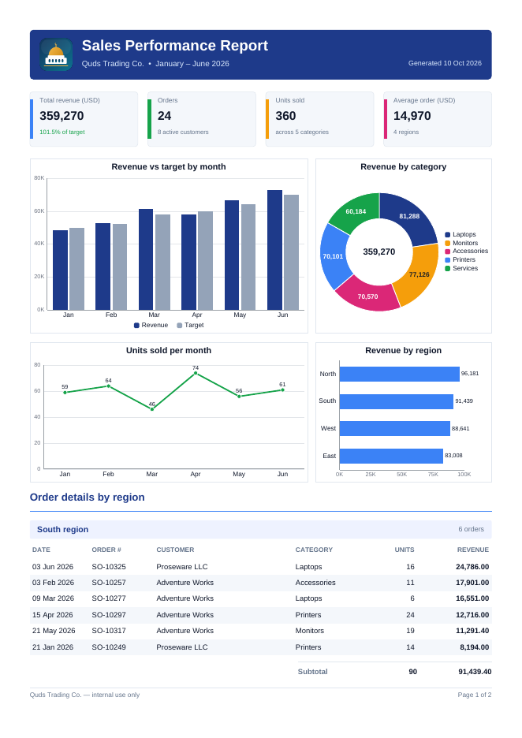</td>
    <td width="33%"></td>
    <td width="33%">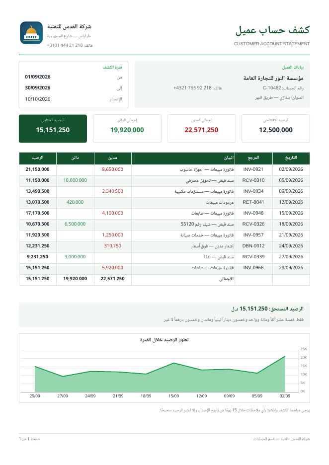</td>
  </tr>
  <tr>
    <td>Sales dashboard: KPI cards, vector charts, grouped table</td>
    <td>Arabic RTL invoice: QR code, tafqeet, totals</td>
    <td>Account statement: running balance, area chart</td>
  </tr>
</table>

<table>
  <tr>
    <td width="33%">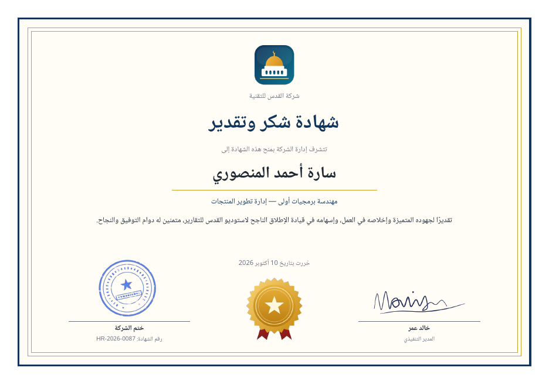</td>
    <td width="33%">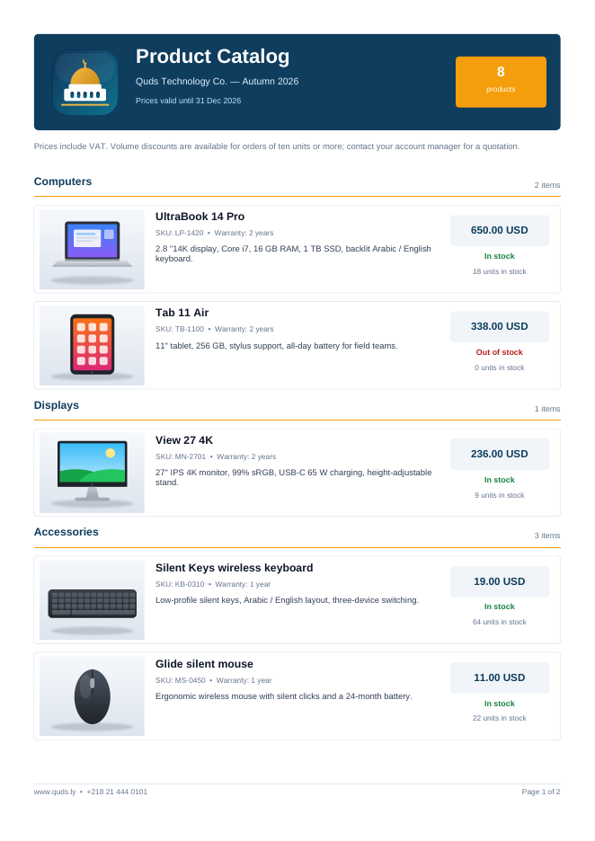</td>
    <td width="33%">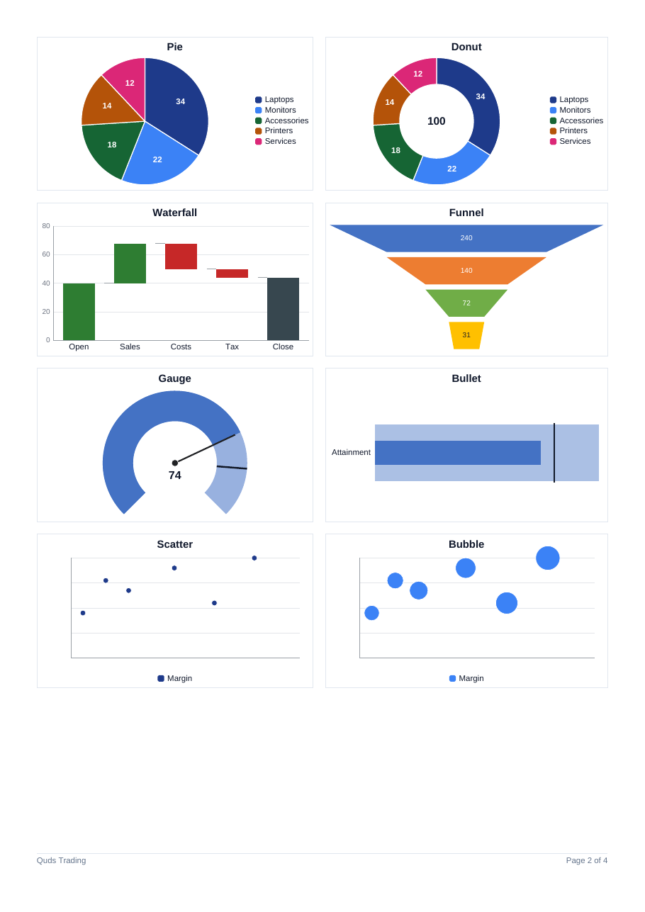</td>
  </tr>
  <tr>
    <td>Certificate with seal and signature saved in the file</td>
    <td>Catalog: photos travel inside the <code>.qrep</code></td>
    <td>Charts drawn as vectors, including extruded columns</td>
  </tr>
</table>

## Install

```yaml
dependencies:
  quds_reports: ^1.5.0
```

```dart
import 'package:quds_reports/quds_reports.dart';
```

The Flutter designer is a second import, in
[`quds_office_editor`](https://pub.dev/packages/quds_office_editor):

```yaml
dependencies:
  quds_office_editor: ^1.5.0
```

```dart
import 'package:quds_office_editor/quds_reports.dart';
```

That import is this library plus `QudsReportDesigner`.

## Quds Report Studio

[Quds Report Studio](https://github.com/MohammedAsaadAsaad/quds_office_suite/tree/main/apps/quds_report_studio)
is the free desktop app for drawing these reports. You design the layout
there, save a `.qrep`, then your Dart program opens that file, passes
variables and data, and exports. The studio ships 20 ready-made templates,
Arabic and English: invoices, statements, vouchers, inventory, catalogs,
certificates, class certificates (one page per student), a sales dashboard,
and a chart gallery with a country shape map.

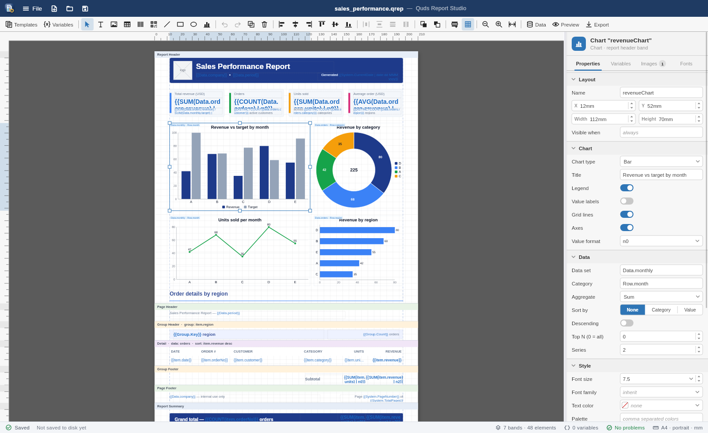

| Platform | Installer | Portable |
| --- | --- | --- |
| Windows 10/11 (x64) | [QudsReportStudio-1.5.0-windows-x64-setup.exe](https://github.com/MohammedAsaadAsaad/quds_office_suite/releases/download/studio-v1.5.0/QudsReportStudio-1.5.0-windows-x64-setup.exe) | [QudsReportStudio-1.5.0-windows-x64-portable.zip](https://github.com/MohammedAsaadAsaad/quds_office_suite/releases/download/studio-v1.5.0/QudsReportStudio-1.5.0-windows-x64-portable.zip) |
| Debian / Ubuntu (x64) | [quds-report-studio_1.5.0_amd64.deb](https://github.com/MohammedAsaadAsaad/quds_office_suite/releases/download/studio-v1.5.0/quds-report-studio_1.5.0_amd64.deb) | [QudsReportStudio-1.5.0-linux-x64.tar.gz](https://github.com/MohammedAsaadAsaad/quds_office_suite/releases/download/studio-v1.5.0/QudsReportStudio-1.5.0-linux-x64.tar.gz) |

- **Windows:** run the setup. It doesn't need admin rights unless you
  choose "all users". Uninstall it from *Settings › Apps*.
- **Debian / Ubuntu:** `sudo apt install ./quds-report-studio_1.5.0_amd64.deb`,
  and `sudo apt remove quds-report-studio` to uninstall.
- **Other Linux distributions:** extract the tar.gz and run `./install.sh`
  (per user, no root). Run `~/.local/opt/quds-report-studio/uninstall.sh`
  to remove it.
- **`.qrep` files:** on its first run the studio registers itself as the app
  for `.qrep` files, so double-clicking a report opens it in the studio.

Checksums and every build are on the
[studio 1.5.0 release](https://github.com/MohammedAsaadAsaad/quds_office_suite/releases/tag/studio-v1.5.0).

<table>
  <tr>
    <td width="50%">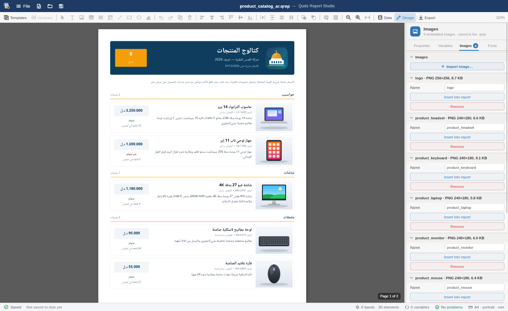</td>
    <td width="50%">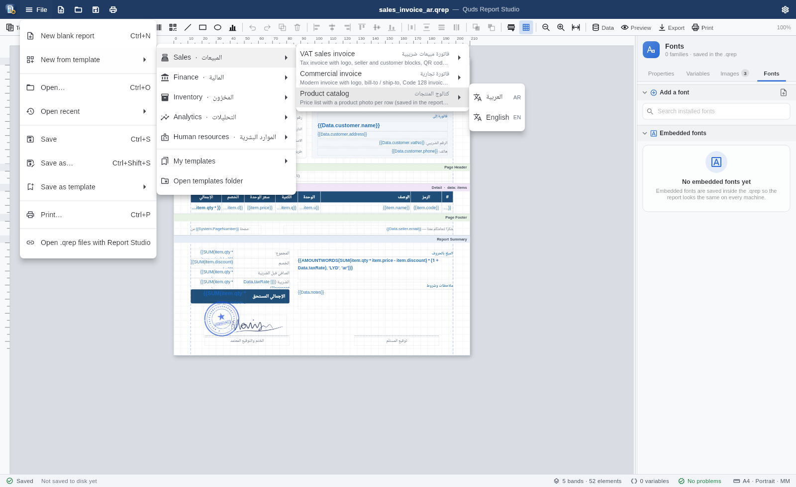</td>
  </tr>
  <tr>
    <td>A catalog template, photos saved inside the <code>.qrep</code></td>
    <td>The template gallery: Arabic and English families</td>
  </tr>
  <tr>
    <td>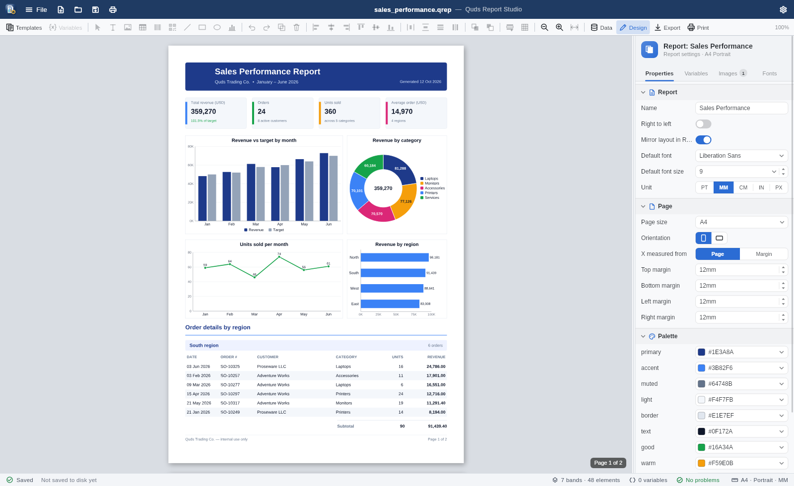</td>
    <td></td>
  </tr>
  <tr>
    <td>Preview: the same pages the PDF export writes</td>
    <td>Arabic invoice on the design canvas</td>
  </tr>
</table>

## Read a `.qrep`, pass variables and data, export

This is the path a server takes. The `.qrep` already holds the layout, the
images, the fonts, and the rows the studio previewed. You override the
variables, replace the data, and export. Preview rows stay in the file for
the next time someone opens it in the studio. Export uses what you pass.

```dart
import 'dart:io';
import 'dart:typed_data';

import 'package:quds_reports/quds_reports.dart';

Future<void> main() async {
  final QudsReportEngine engine = QudsReportEngine.fromPackage(
    File('invoice.qrep').readAsBytesSync(),
    variables: <String, Object?>{
      'company': 'Northwind Traders',
      'vatRate': 0.15,
    },
  );

  // Live data. Names match <Field>, <Table>, and {{Data.*}} in the file.
  engine.data
    ..set('customer', 'Contoso Ltd')
    ..set('invoiceNo', 'INV-2026-014')
    ..setTable('items', <Map<String, Object?>>[
      <String, Object?>{'name': 'Laptop 14"', 'qty': 2, 'price': 1250},
      <String, Object?>{'name': 'Monitor 27" 4K', 'qty': 3, 'price': 410},
      <String, Object?>{'name': 'Docking station', 'qty': 2, 'price': 189.5},
    ]);

  // The map wins over engine.data on the same key. An empty map keeps it.
  final Uint8List pdf = await engine.exportToPdf(const <String, Object?>{});
  final Uint8List xlsx = engine.exportToExcelSync(const <String, Object?>{});
  final Uint8List docx = engine.exportToWordSync(const <String, Object?>{});

  File('invoice.pdf').writeAsBytesSync(pdf);
  File('invoice.xlsx').writeAsBytesSync(xlsx);
  File('invoice.docx').writeAsBytesSync(docx);
}
```

`variables:` replaces `<Var>` values from the file (`Variables.company`,
`Variables.vatRate`). `engine.data` fills `Data.customer`, `Data.invoiceNo`,
and the `items` table. A calculated column such as `line = qty * price`
is filled before totals and `{{item.line}}` run.

A runnable copy writes a small `.qrep`, reads it back, and exports all
three formats:

```bash
dart run example/fill_qrep.dart
```

[`example/fill_qrep.dart`](example/fill_qrep.dart).

`engine.validate()` lists expression errors before you export. `strict: true`
on the engine throws instead of printing `#ERR`.

### The same report, three files

<table>
  <tr>
    <td width="33%"></td>
    <td width="33%">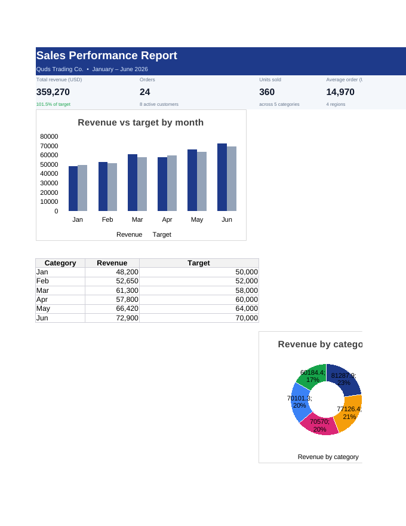</td>
    <td width="33%">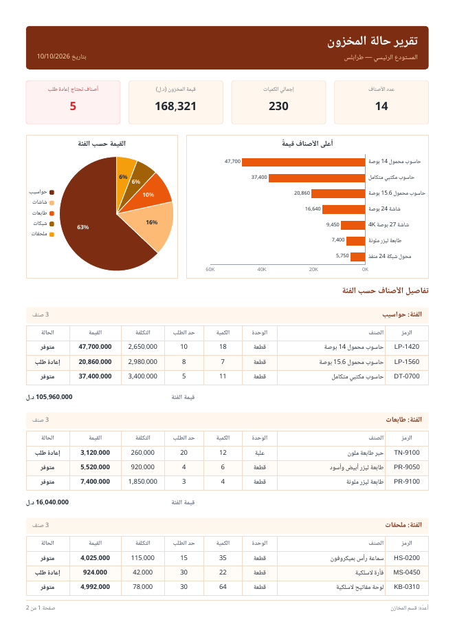</td>
  </tr>
  <tr>
    <td>PDF, paginated by the engine</td>
    <td>XLSX with native Excel charts</td>
    <td>Arabic inventory: pie, bars, groups</td>
  </tr>
</table>

## What you can put in a report

<table>
  <tr>
    <td width="50%">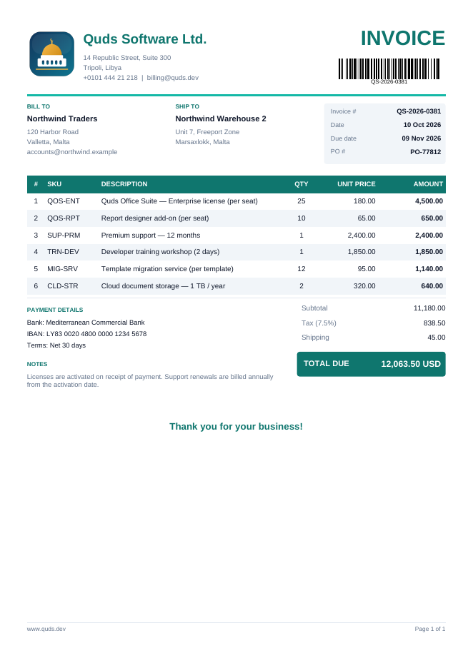</td>
    <td width="50%">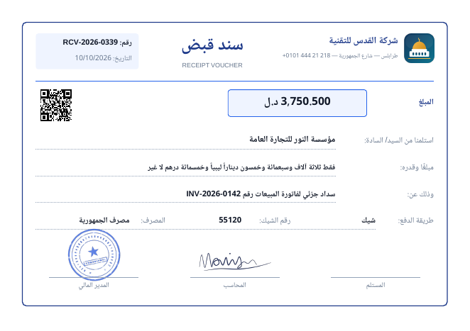</td>
  </tr>
  <tr>
    <td>English invoice with a Code 128 barcode</td>
    <td>Arabic receipt voucher</td>
  </tr>
  <tr>
    <td>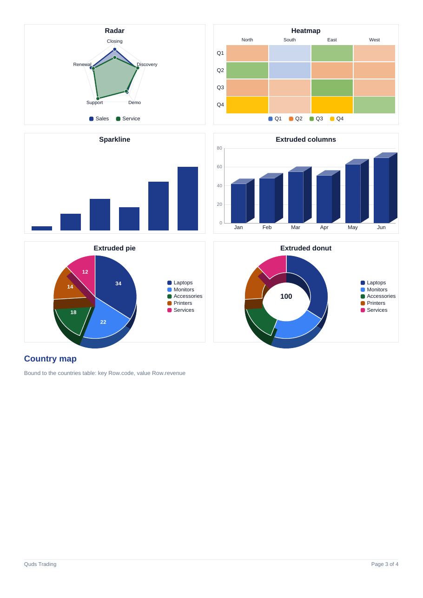</td>
    <td>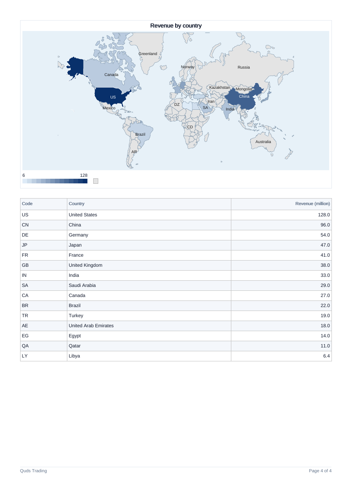</td>
  </tr>
  <tr>
    <td>Extruded columns, pies, and donuts</td>
    <td>Shape map colored from a table, with labels</td>
  </tr>
</table>

| Piece | What it does |
| --- | --- |
| **Bands** | Report header, page header, group header, detail, group footer, page footer, report summary |
| **Detail** | One row per record, or one whole page per record (class certificates, mail-merge style) |
| **Elements** | Text, image, table, barcode, QR, shape, chart, shape map |
| **Charts** | Column, bar, line, area, pie, donut, stacked, combo, waterfall, gauge, bullet, funnel, scatter, bubble, radar, heatmap, sparkline, extruded |
| **Expressions** | `{{Data.customer}}`, `{{item.qty * item.price \| n2}}`, `SUM`, `TAFQEET` |
| **Variables** | Typed values the host overrides per export: company name, tax rate, labels |
| **Data** | Fields, tables, typed columns, calculated columns (`qty * price`) |
| **Package** | Images, TrueType fonts, and shape layers saved inside the `.qrep` |
| **Directions** | LTR and RTL. Arabic templates mirror the X axis |

## Inside the studio

<table>
  <tr>
    <td width="50%"></td>
    <td width="50%">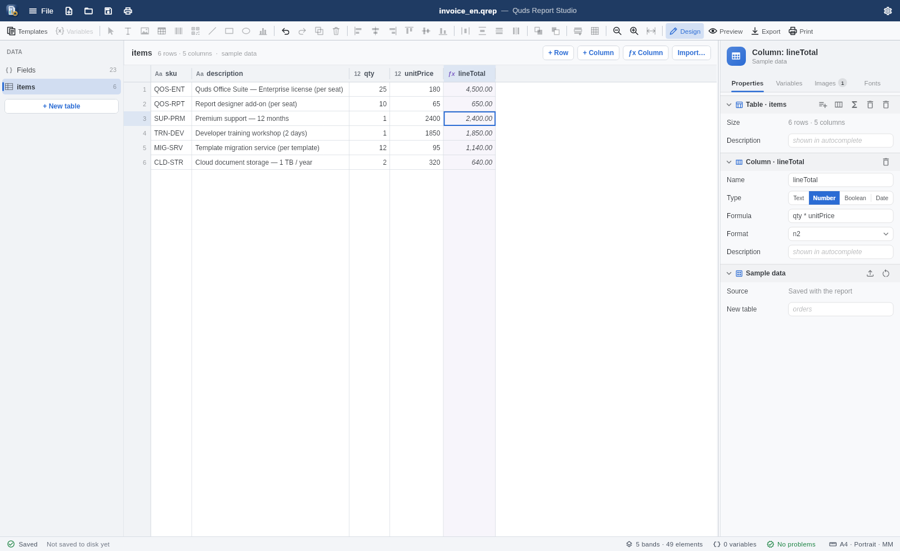</td>
  </tr>
  <tr>
    <td>Chart inspector: type, series, and plot</td>
    <td>Data explorer: tables, types, calculated columns</td>
  </tr>
  <tr>
    <td></td>
    <td>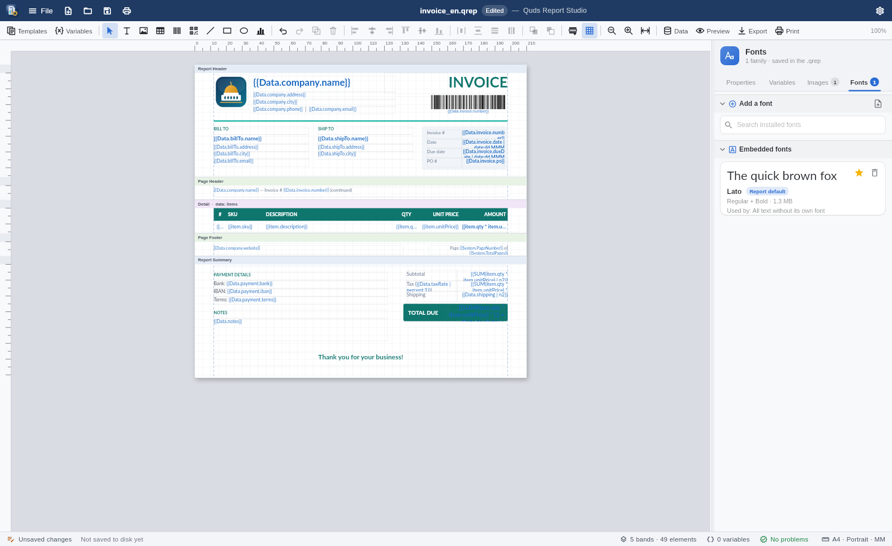</td>
  </tr>
  <tr>
    <td>Variables the host will override at export</td>
    <td>Fonts embedded in the <code>.qrep</code></td>
  </tr>
  <tr>
    <td>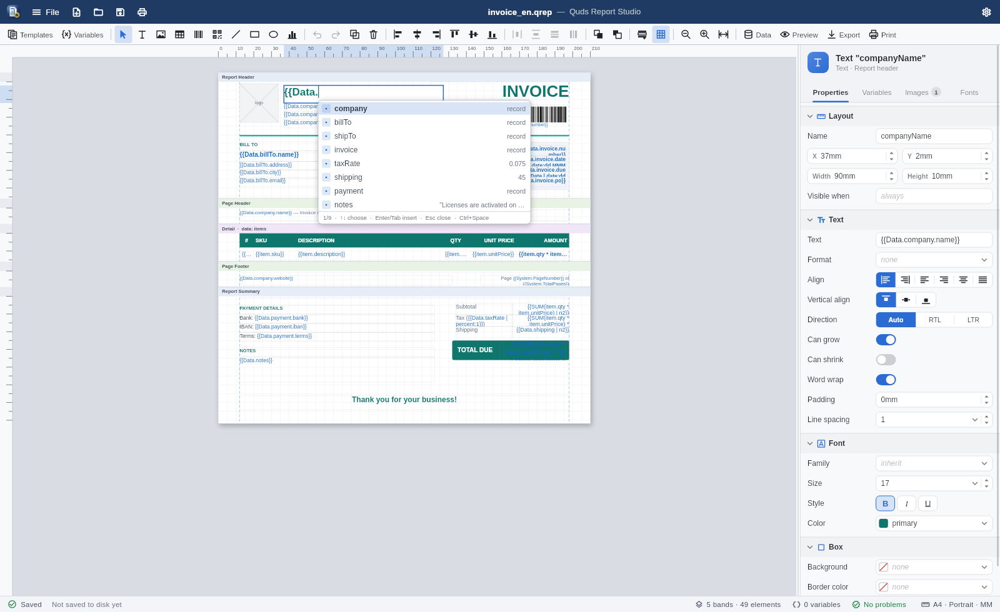</td>
    <td>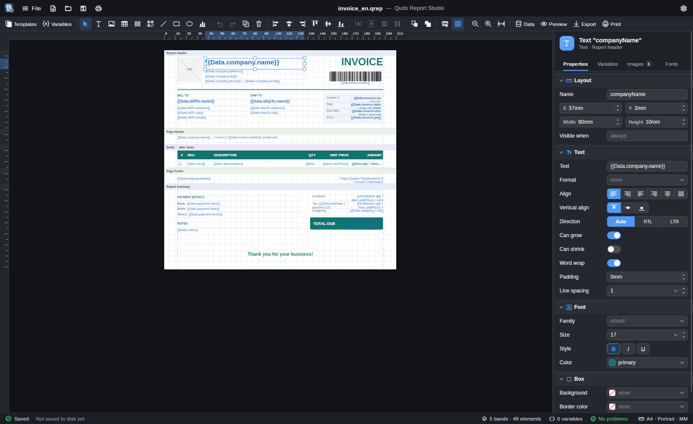</td>
  </tr>
  <tr>
    <td><code>{{ }}</code> suggestions from the sample data</td>
    <td>Dark chrome. The page stays white, like paper</td>
  </tr>
  <tr>
    <td>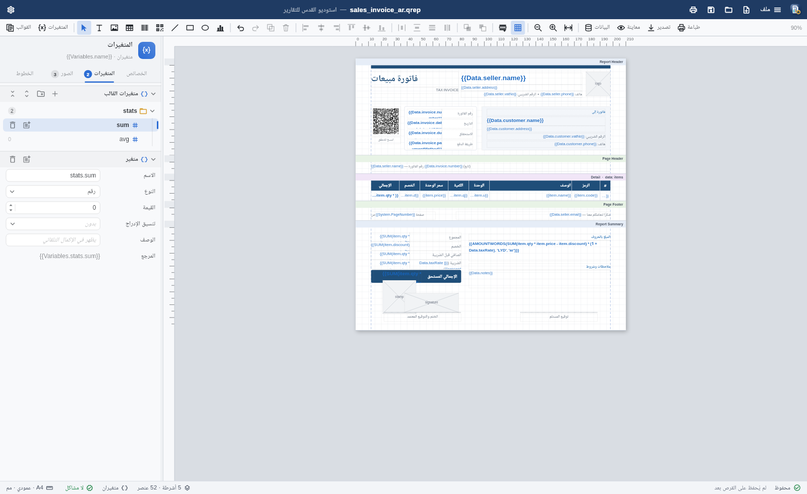</td>
    <td></td>
  </tr>
  <tr>
    <td>The studio itself in Arabic</td>
    <td>The certificate that file exports to</td>
  </tr>
</table>

Embed the same designer in your own Flutter app:

```dart
import 'dart:io';
import 'dart:typed_data';

import 'package:quds_office_editor/quds_reports.dart';

final ReportDesignerController controller = ReportDesignerController.fromPackage(
  File('invoice.qrep').readAsBytesSync(),
);

QudsReportDesigner(
  controller: controller,
  onExport: (ReportExportFormat format, Uint8List bytes) {
    // format.name is pdf, xlsx, or docx
  },
);
```

`ReportTemplateLibrary.bundled()` loads the 22 templates that ship with the
editor. Download the studio from the links above if you want the designer
without embedding it.

## The `.qrep` file

```text
invoice.qrep
├── mimetype            application/vnd.quds.qrep+zip
├── layout.xml          <QudsReport> bands, variables, schema
├── data/sample.json    rows the studio previews with
├── images/logo.png     <Image source="logo"/>
├── fonts/Amiri/regular.ttf
├── fonts/Amiri/bold.ttf
└── shapes/districts.qmap
```

```dart
final ReportPackage package = ReportPackage.decode(File('invoice.qrep').readAsBytesSync());
final QudsReportEngine engine = QudsReportEngine.fromPackage(
  File('invoice.qrep').readAsBytesSync(),
  variables: <String, Object?>{'vatRate': 0.15},
);
```

Images are PNG or JPEG. Fonts are single glyf `.ttf` files. Each entry is
limited to 64 MB. `fromPackage` registers the embedded fonts beside any
`fonts:` you pass, and your families win when a name appears in both. An
older plain-XML `.qrep` still opens.

Build one in code when you have no studio file yet:

```dart
final Uint8List bytes = ReportPackage(
  xml: layoutXml,
  images: <String, Uint8List>{'logo': pngBytes},
  fonts: <String, ReportFontFiles>{
    'Amiri': ReportFontFiles(regular: regularTtf, bold: boldTtf),
  },
  sampleData: <String, Object?>{
    'customer': 'Preview customer',
    'items': <Map<String, Object?>>[
      <String, Object?>{'name': 'Sample', 'qty': 1, 'price': 1},
    ],
  },
).encode();
File('invoice.qrep').writeAsBytesSync(bytes);
```

Latin text with no registered font is drawn with PDF Helvetica. Arabic needs
a TrueType face in the package or in `fonts:`.

## Expressions

Placeholders are `{{ }}` inside text. A property that is itself an expression
(`visibleWhen`, a calculated column) is parsed without braces.

| | |
| --- | --- |
| **Paths** | `Data.*`, `item.*` on a detail row, `Group.*`, `Variables.*`, `System.PageNumber`, `System.TotalPages`, `System.CurrentDate`, `System.UserName`, `Row.*` on a shape feature |
| **Math** | `+ - * / %`, `ROUND`, `FLOOR`, `CEIL`, `ABS` |
| **Logic** | `= != < <= > >=`, `and` / `or` / `not`, `IF(cond, a, b)` |
| **Aggregates** | `SUM`, `COUNT`, `AVG`, `MIN`, `MAX` |
| **Formats** | `\| n2`, `\| currency:USD`, `\| percent`, `\| date:dd MMM yyyy`, `\| dateAr:` |
| **Amount in words** | `TAFQEET(amount, "SAR")` for Arabic currencies, `AMOUNTWORDS(amount, "USD", "en")` for English or Arabic |

```dart
QudsReportEngine.fromPackage(
  bytes,
  functions: <String, ReportFunction>{
    'VAT': (List<ReportValue> args) =>
        ReportNumber((args.first.asNumber ?? 0) * 0.15),
  },
);
```

## Fill elements by name

```dart
final QudsReportEngine engine = QudsReportEngine.fromPackage(qrepBytes);
engine.setText('title', 'Quarterly invoice');
engine.setImage('logo', logoPng);
engine.setVisible('discountNote', false);
engine.elementAs<ReportTextElement>('title').style.color = '#C00000';
final Uint8List pdf = await engine.export(ReportExportFormat.pdf);
```

Names are unique in the template. `setText` / `setImage` / `setVisible`
address the element. Variables and `engine.data` address the values those
elements print.

## PDF options

```dart
final Uint8List pdf = await engine.exportToPdf(
  const <String, Object?>{},
  options: const PdfSaveOptions(pdfA: true, tagged: true),
);
```

`pdfA` writes PDF/A-oriented catalog extras (embedded fonts are required for
text outside WinAnsi). `tagged` writes a structure tree from the document
outline.

## One object, two hosts

`QudsReportEngine` from this package is the engine the studio and
`QudsReportDesigner` edit. A `.qrep` saved in the studio opens here, and
bytes written here open in the studio.

| You are building | Import |
| --- | --- |
| A server, a CLI, a queue worker | `package:quds_reports/quds_reports.dart` |
| A Flutter designer | `package:quds_office_editor/quds_reports.dart` |
| The desktop app itself | [Quds Report Studio](https://github.com/MohammedAsaadAsaad/quds_office_suite/releases/tag/studio-v1.5.0) |

Word, Excel, PowerPoint, and `PdfFile` stay in
[`quds_office_engine`](https://pub.dev/packages/quds_office_engine). This
package is the report door onto that engine.
